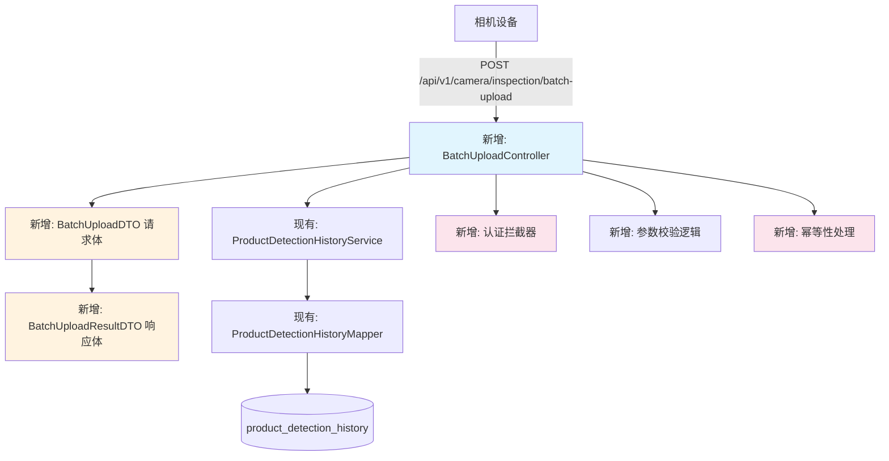

# 批量数据上报接口开发方案

> ⚠️ **历史设计文档（2026-05-16，系统投产前）**
> 本文描述的是早期接口设计与实现方案，其中的类名、表结构、字段可能与当前代码不一致。
> **现行接口以 [`docs/接口文档.md`](../../接口文档.md)（135 端点，自动生成）为准**；
> 业务口径以 [`docs/架构说明.md`](../../架构说明.md) 为准。
> 保留本文是因为它记录了「为什么这样设计」，不是因为它还是对的。


> **版本**: v1.0  
> **日期**: 2026-05-16  
> **说明**: 基于 `数据上报接口.txt` 需求文档，分析当前代码架构，输出接口实现开发方案。

---

## 一、需求文档与当前代码对比分析

### 1.1 接口定义对比

| 对比项 | 需求文档 | 当前代码 | 匹配情况 |
|--------|----------|----------|----------|
| 接口路径 | `/api/v1/camera/inspection/batch-upload` | `/api/detection-history/import-excel-V2` | ❌ 不匹配 |
| 请求方式 | `POST` | `POST` | ✅ 匹配 |
| 数据格式 | `application/json` | `multipart/form-data` (Excel文件) | ❌ 不匹配 |
| 请求体 | JSON数组（`dataList`） | Excel文件 | ❌ 不匹配 |
| 认证方式 | `Authorization: Bearer {token}` | 无认证 | ❌ 需新增 |
| 设备ID | `X-Device-Id` 请求头 | 无 | ❌ 需新增 |
| 批次号 | `X-Batch-Id` 请求头 | 无 | ❌ 需新增 |
| 幂等性 | 基于 `startTime + cameraName` 唯一索引 | 无此机制 | ❌ 需新增 |
| 响应格式 | 详细处理结果（successCount/failCount/details） | 简单成功/失败消息 | ❌ 需新增 |

### 1.2 字段对比分析

#### 1.2.1 请求体字段匹配情况

| 需求字段 | 当前实体字段 | 匹配情况 | 说明 |
|----------|--------------|----------|------|
| deviceId | 无 | ❌ 需新增 | 相机设备编号，请求体顶层字段 |
| batchTime | 无 | ❌ 需新增 | 批次上报时间，请求体顶层字段 |
| recordCount | 无 | ❌ 需新增 | 本批次记录数量，请求体顶层字段 |
| dataList | 无 | ❌ 需新增 | 检测数据数组，请求体顶层字段 |
| dataList[].startTime | startTime | ✅ 匹配 | |
| dataList[].endTime | endTime | ✅ 匹配 | |
| dataList[].productName | productName | ✅ 匹配 | |
| dataList[].cameraName | cameraName | ✅ 匹配 | |
| dataList[].totalCount | totalCount | ✅ 匹配 | |
| dataList[].okCount | okCount | ✅ 匹配 | |
| dataList[].ngCount | ngCount | ✅ 匹配 | |
| dataList[].materialJoint | materialJoint | ✅ 匹配 | |
| dataList[].innerGlue13 | innerGlue13 | ✅ 匹配 | 注意：当前代码字段名为 `innerGlue13`（无下划线） |
| dataList[].innerGlue3Plus | innerGlue3Plus | ✅ 匹配 | 同上 |
| dataList[].frontWaistGlue13 | frontWaistGlue13 | ✅ 匹配 | 同上 |
| dataList[].frontWaistGlue3Plus | frontWaistGlue3Plus | ✅ 匹配 | 同上 |
| dataList[].backWaistGlue13 | backWaistGlue13 | ✅ 匹配 | 同上 |
| dataList[].backWaistGlue3Plus | backWaistGlue3Plus | ✅ 匹配 | 同上 |
| dataList[].innerOuterGlue13 | innerOuterGlue13 | ✅ 匹配 | 同上 |
| dataList[].innerOuterGlue3Plus | innerOuterGlue3Plus | ✅ 匹配 | 同上 |
| dataList[].innerDefect1 | innerDefect1 | ✅ 匹配 | |
| dataList[].innerDefect13 | innerDefect13 | ✅ 匹配 | |
| dataList[].innerDefect3Plus | innerDefect3Plus | ✅ 匹配 | |
| dataList[].frontWaistDefect1 | frontWaistDefect1 | ✅ 匹配 | |
| dataList[].frontWaistDefect13 | frontWaistDefect13 | ✅ 匹配 | |
| dataList[].frontWaistDefect3Plus | frontWaistDefect3Plus | ✅ 匹配 | |
| dataList[].backWaistDefect1 | backWaistDefect1 | ✅ 匹配 | |
| dataList[].backWaistDefect13 | backWaistDefect13 | ✅ 匹配 | |
| dataList[].backWaistDefect3Plus | backWaistDefect3Plus | ✅ 匹配 | |
| dataList[].innerOuterDefect1 | innerOuterDefect1 | ✅ 匹配 | |
| dataList[].innerOuterDefect13 | innerOuterDefect13 | ✅ 匹配 | |
| dataList[].innerOuterDefect3Plus | innerOuterDefect3Plus | ✅ 匹配 | |
| dataList[].recordType | recordType | ✅ 匹配 | |
| dataList[].exceptionType | exceptionType | ✅ 匹配 | |
| dataList[].exceptionItems | exceptionItems | ✅ 匹配 | |
| dataList[].incrementalTotal | incrementalTotal | ✅ 匹配 | |
| dataList[].incrementalOk | incrementalOk | ✅ 匹配 | |
| dataList[].incrementalNg | incrementalNg | ✅ 匹配 | |

#### 1.2.2 响应格式匹配情况

| 需求字段 | 当前返回 | 匹配情况 | 说明 |
|----------|----------|----------|------|
| code | code | ✅ 匹配 | 但需求定义200/207，当前用0/1 |
| message | message | ✅ 匹配 | |
| data.batchId | 无 | ❌ 需新增 | |
| data.totalRecords | 无 | ❌ 需新增 | |
| data.successCount | 无 | ❌ 需新增 | |
| data.failCount | 无 | ❌ 需新增 | |
| data.duplicateCount | 无 | ❌ 需新增 | |
| data.processedTime | 无 | ❌ 需新增 | |
| data.details | 无 | ❌ 需新增 | 每条记录的处理详情 |

#### 1.2.3 自动处理字段匹配情况

| 需求字段 | 当前处理 | 匹配情况 |
|----------|----------|----------|
| id (主键) | 数据库自增 | ✅ 匹配 |
| illegalNgCount | 有计算逻辑（`importFromExcel`中） | ✅ 匹配 |
| dataSource | 部分接口设置 | ⚠️ 需统一为 `batch_api_push` |
| createTime | 自动填充 | ✅ 匹配 |
| updateTime | 自动填充 | ✅ 匹配 |
| isProcessed | 有处理 | ✅ 匹配 |

---

## 二、开发方案

### 2.1 整体架构设计



### 2.2 数据库变更

#### 2.2.1 新增唯一索引

```sql
-- 用于幂等性控制：相同 startTime + cameraName 视为同一记录
ALTER TABLE product_detection_history 
ADD UNIQUE INDEX uk_start_time_camera (start_time, camera_name);
```

#### 2.2.2 新增字段（可选）

```sql
-- 设备ID字段（用于追踪数据来源设备）
ALTER TABLE product_detection_history 
ADD COLUMN device_id VARCHAR(50) COMMENT '设备ID' AFTER camera_name;

-- 批次ID字段（用于追踪批次）
ALTER TABLE product_detection_history 
ADD COLUMN batch_id VARCHAR(50) COMMENT '批次ID' AFTER device_id;
```

---

### 2.3 代码变更清单

| 变更类型 | 文件路径 | 说明 | 优先级 |
|----------|----------|------|----------|
| **新增** | `dto/BatchUploadDTO.java` | 请求体DTO（包含deviceId、batchTime、recordCount、dataList） | P0 |
| **新增** | `dto/BatchUploadResultDTO.java` | 响应体DTO（包含batchId、totalRecords、successCount等） | P0 |
| **新增** | `dto/BatchUploadResultDetailDTO.java` | 处理详情DTO（包含index、startTime、status、id、message） | P0 |
| **新增** | `controller/BatchUploadController.java` | 批量上报接口Controller | P0 |
| **修改** | `service/IProductDetectionHistoryService.java` | 新增 `batchUpload()` 方法定义 | P0 |
| **修改** | `service/impl/ProductDetectionHistoryServiceImpl.java` | 实现 `batchUpload()` 方法 | P0 |
| **修改** | `mapper/ProductDetectionHistoryMapper.java` | 新增 `upsert()` 方法（存在则更新，不存在则插入） | P0 |
| **新增** | `mapper/ProductDetectionHistoryMapper.xml` | 新增 upsert SQL 语句 | P0 |
| **新增** | `config/SecurityConfig.java` | Spring Security配置（如果需要认证） | P1 |
| **新增** | `interceptor/AuthInterceptor.java` | 认证拦截器（校验Token和设备ID） | P1 |
| **修改** | `entity/ProductDetectionHistory.java` | 新增 deviceId、batchId 字段（可选） | P2 |

---

### 2.4 核心代码实现

#### 2.4.1 新增 DTO：BatchUploadDTO.java

```java
package com.wms.dto;

import com.wms.entity.ProductDetectionHistory;
import lombok.Data;
import java.io.Serializable;
import java.time.LocalDateTime;
import java.util.List;

/**
 * 批量上报请求体 DTO
 */
@Data
public class BatchUploadDTO implements Serializable {
    private static final long serialVersionUID = 1L;

    /**
     * 相机设备编号
     */
    private String deviceId;

    /**
     * 批次上报时间
     */
    private String batchTime;

    /**
     * 本批次记录数量
     */
    private Integer recordCount;

    /**
     * 检测数据数组
     */
    private List<DetectionDataDTO> dataList;

    /**
     * 内部类：单条检测数据
     */
    @Data
    public static class DetectionDataDTO implements Serializable {
        private static final long serialVersionUID = 1L;

        private String startTime;  // yyyy-MM-dd HH:mm:ss
        private String endTime;    // yyyy-MM-dd HH:mm:ss
        private String productName;
        private String cameraName;
        private Integer totalCount;
        private Integer okCount;
        private Integer ngCount;
        private Integer materialJoint;
        private Integer innerGlue13;
        private Integer innerGlue3Plus;
        private Integer frontWaistGlue13;
        private Integer frontWaistGlue3Plus;
        private Integer backWaistGlue13;
        private Integer backWaistGlue3Plus;
        private Integer innerOuterGlue13;
        private Integer innerOuterGlue3Plus;
        private Integer innerDefect1;
        private Integer innerDefect13;
        private Integer innerDefect3Plus;
        private Integer frontWaistDefect1;
        private Integer frontWaistDefect13;
        private Integer frontWaistDefect3Plus;
        private Integer backWaistDefect1;
        private Integer backWaistDefect13;
        private Integer backWaistDefect3Plus;
        private Integer innerOuterDefect1;
        private Integer innerOuterDefect13;
        private Integer innerOuterDefect3Plus;
        private Integer recordType;
        private Integer exceptionType;
        private String exceptionItems;
        private Integer incrementalTotal;
        private Integer incrementalOk;
        private Integer incrementalNg;
    }
}
```

#### 2.4.2 新增 DTO：BatchUploadResultDTO.java

```java
package com.wms.dto;

import lombok.Data;
import java.io.Serializable;
import java.util.List;

/**
 * 批量上报响应体 DTO
 */
@Data
public class BatchUploadResultDTO implements Serializable {
    private static final long serialVersionUID = 1L;

    /**
     * 批次号
     */
    private String batchId;

    /**
     * 总记录数
     */
    private Integer totalRecords;

    /**
     * 成功条数
     */
    private Integer successCount;

    /**
     * 失败条数
     */
    private Integer failCount;

    /**
     * 重复条数（幂等性控制）
     */
    private Integer duplicateCount;

    /**
     * 处理完成时间
     */
    private String processedTime;

    /**
     * 处理详情
     */
    private List<BatchUploadResultDetailDTO> details;
}
```

#### 2.4.3 新增 DTO：BatchUploadResultDetailDTO.java

```java
package com.wms.dto;

import lombok.Data;
import java.io.Serializable;

/**
 * 批量上报处理详情 DTO
 */
@Data
public class BatchUploadResultDetailDTO implements Serializable {
    private static final long serialVersionUID = 1L;

    /**
     * 记录在数组中的索引
     */
    private Integer index;

    /**
     * 开始时间（用于标识记录）
     */
    private String startTime;

    /**
     * 处理状态：success / fail / duplicate
     */
    private String status;

    /**
     * 数据库记录ID（成功时返回）
     */
    private Long id;

    /**
     * 处理消息
     */
    private String message;
}
```

#### 2.4.4 新增 Controller：BatchUploadController.java

```java
package com.wms.controller;

import com.wms.dto.BatchUploadDTO;
import com.wms.dto.BatchUploadResultDTO;
import com.wms.service.IProductDetectionHistoryService;
import com.wms.vo.ResultVO;
import lombok.extern.slf4j.Slf4j;
import org.springframework.beans.factory.annotation.Autowired;
import org.springframework.web.bind.annotation.*;

/**
 * 批量数据上报接口 Controller
 */
@RestController
@RequestMapping("/api/v1/camera/inspection")
@Slf4j
public class BatchUploadController {

    @Autowired
    private IProductDetectionHistoryService detectionHistoryService;

    /**
     * 批量上报检测数据
     * 接口路径：POST /api/v1/camera/inspection/batch-upload
     */
    @PostMapping("/batch-upload")
    public ResultVO<BatchUploadResultDTO> batchUpload(
            @RequestHeader(value = "Authorization", required = false) String authorization,
            @RequestHeader(value = "X-Device-Id", required = false) String deviceIdHeader,
            @RequestHeader(value = "X-Batch-Id", required = false) String batchIdHeader,
            @RequestBody BatchUploadDTO batchUploadDTO) {
        
        try {
            // TODO: 1. 校验 Token（如果需要认证）
            if (authorization == null || !authorization.startsWith("Bearer ")) {
                return ResultVO.fail("缺少认证令牌");
            }
            String token = authorization.substring(7);
            
            // TODO: 2. 校验设备ID
            if (deviceIdHeader == null || deviceIdHeader.trim().isEmpty()) {
                return ResultVO.fail("缺少设备ID");
            }
            
            // 3. 校验 dataList 非空
            if (batchUploadDTO.getDataList() == null || batchUploadDTO.getDataList().isEmpty()) {
                return ResultVO.fail("dataList 不能为空");
            }
            
            // 4. 校验 dataList 条数限制（≤100条）
            if (batchUploadDTO.getDataList().size() > 100) {
                return ResultVO.fail("单次上报记录数不能超过100条");
            }
            
            // 5. 调用 Service 处理批量数据
            BatchUploadResultDTO result = detectionHistoryService.batchUpload(
                    batchUploadDTO, deviceIdHeader, batchIdHeader);
            
            // 6. 根据处理结果返回对应 HTTP 状态码
            if (result.getFailCount() == 0) {
                // 全部成功：HTTP 200
                return ResultVO.success(result, "全部处理成功");
            } else if (result.getSuccessCount() > 0) {
                // 部分成功：HTTP 207
                return ResultVO.success(result, "部分记录处理失败");
            } else {
                // 全部失败：HTTP 400
                return ResultVO.fail("所有记录处理失败");
            }
            
        } catch (Exception e) {
            log.error("批量上报接口异常", e);
            return ResultVO.fail("服务器内部错误：" + e.getMessage());
        }
    }
}
```

#### 2.4.5 修改 Service 接口：IProductDetectionHistoryService.java

```java
/**
 * 批量上报检测数据
 * @param batchUploadDTO 批量上报请求体
 * @param deviceId 设备ID（从请求头获取）
 * @param batchId 批次ID（从请求头获取）
 * @return 处理结果
 */
BatchUploadResultDTO batchUpload(BatchUploadDTO batchUploadDTO, String deviceId, String batchId);
```

#### 2.4.6 修改 Service 实现：ProductDetectionHistoryServiceImpl.java

```java
@Override
@Transactional(rollbackFor = Exception.class)
public BatchUploadResultDTO batchUpload(BatchUploadDTO batchUploadDTO, String deviceId, String batchId) {
    BatchUploadResultDTO result = new BatchUploadResultDTO();
    
    // 1. 生成批次号（如果请求头没有传，则自动生成）
    String batchIdStr = (batchId != null && !batchId.trim().isEmpty()) 
            ? batchId 
            : "BATCH" + System.currentTimeMillis();
    result.setBatchId(batchIdStr);
    result.setTotalRecords(batchUploadDTO.getDataList().size());
    result.setProcessedTime(LocalDateTime.now().format(DateTimeFormatter.ofPattern("yyyy-MM-dd HH:mm:ss")));
    
    int successCount = 0;
    int failCount = 0;
    int duplicateCount = 0;
    List<BatchUploadResultDetailDTO> details = new ArrayList<>();
    
    // 2. 遍历处理每条记录
    for (int i = 0; i < batchUploadDTO.getDataList().size(); i++) {
        BatchUploadDTO.DetectionDataDTO dataDTO = batchUploadDTO.getDataList().get(i);
        BatchUploadResultDetailDTO detail = new BatchUploadResultDetailDTO();
        detail.setIndex(i);
        detail.setStartTime(dataDTO.getStartTime());
        
        try {
            // 3. 校验时间格式
            LocalDateTime startTime = ExcelUtils.parseDateTime(dataDTO.getStartTime());
            LocalDateTime endTime = ExcelUtils.parseDateTime(dataDTO.getEndTime());
            if (startTime == null || endTime == null) {
                throw new IllegalArgumentException("时间格式错误，应为 yyyy-MM-dd HH:mm:ss");
            }
            
            // 4. 转换 DTO → Entity
            ProductDetectionHistory entity = convertDTOtoEntity(dataDTO);
            entity.setDataSource("batch_api_push");
            entity.setIsProcessed(0);
            
            // 5. 计算 illegalNgCount
            int actualNgCount = calculateActualNgCount(entity);
            entity.setIllegalNgCount(entity.getNgCount() - actualNgCount);
            
            // 6. 幂等性处理：根据 startTime + cameraName 查询是否已存在
            ProductDetectionHistory existRecord = detectionHistoryMapper.selectByStartTimeAndCameraName(
                    entity.getStartTime(), entity.getCameraName());
            
            if (existRecord != null) {
                // 已存在：执行 UPDATE
                entity.setId(existRecord.getId());
                detectionHistoryMapper.updateById(entity);
                detail.setStatus("duplicate");
                detail.setId(existRecord.getId());
                detail.setMessage("记录已存在，执行更新");
                duplicateCount++;
            } else {
                // 不存在：执行 INSERT
                detectionHistoryMapper.insert(entity);
                detail.setStatus("success");
                detail.setId(entity.getId());
                detail.setMessage("插入成功");
                successCount++;
            }
            
        } catch (Exception e) {
            log.error("处理第{}条记录失败，startTime={}", i, dataDTO.getStartTime(), e);
            detail.setStatus("fail");
            detail.setId(null);
            detail.setMessage(e.getMessage());
            failCount++;
        }
        
        details.add(detail);
    }
    
    // 7. 设置返回结果
    result.setSuccessCount(successCount);
    result.setFailCount(failCount);
    result.setDuplicateCount(duplicateCount);
    result.setDetails(details);
    
    return result;
}

/**
 * DTO → Entity 转换
 */
private ProductDetectionHistory convertDTOtoEntity(BatchUploadDTO.DetectionDataDTO dto) {
    ProductDetectionHistory entity = new ProductDetectionHistory();
    entity.setStartTime(ExcelUtils.parseDateTime(dto.getStartTime()));
    entity.setEndTime(ExcelUtils.parseDateTime(dto.getEndTime()));
    entity.setProductName(dto.getProductName());
    entity.setCameraName(dto.getCameraName());
    entity.setTotalCount(dto.getTotalCount() != null ? dto.getTotalCount() : 0);
    entity.setOkCount(dto.getOkCount() != null ? dto.getOkCount() : 0);
    entity.setNgCount(dto.getNgCount() != null ? dto.getNgCount() : 0);
    entity.setMaterialJoint(dto.getMaterialJoint() != null ? dto.getMaterialJoint() : 0);
    entity.setInnerGlue13(dto.getInnerGlue13() != null ? dto.getInnerGlue13() : 0);
    entity.setInnerGlue3Plus(dto.getInnerGlue3Plus() != null ? dto.getInnerGlue3Plus() : 0);
    entity.setFrontWaistGlue13(dto.getFrontWaistGlue13() != null ? dto.getFrontWaistGlue13() : 0);
    entity.setFrontWaistGlue3Plus(dto.getFrontWaistGlue3Plus() != null ? dto.getFrontWaistGlue3Plus() : 0);
    entity.setBackWaistGlue13(dto.getBackWaistGlue13() != null ? dto.getBackWaistGlue13() : 0);
    entity.setBackWaistGlue3Plus(dto.getBackWaistGlue3Plus() != null ? dto.getBackWaistGlue3Plus() : 0);
    entity.setInnerOuterGlue13(dto.getInnerOuterGlue13() != null ? dto.getInnerOuterGlue13() : 0);
    entity.setInnerOuterGlue3Plus(dto.getInnerOuterGlue3Plus() != null ? dto.getInnerOuterGlue3Plus() : 0);
    entity.setInnerDefect1(dto.getInnerDefect1() != null ? dto.getInnerDefect1() : 0);
    entity.setInnerDefect13(dto.getInnerDefect13() != null ? dto.getInnerDefect13() : 0);
    entity.setInnerDefect3Plus(dto.getInnerDefect3Plus() != null ? dto.getInnerDefect3Plus() : 0);
    entity.setFrontWaistDefect1(dto.getFrontWaistDefect1() != null ? dto.getFrontWaistDefect1() : 0);
    entity.setFrontWaistDefect13(dto.getFrontWaistDefect13() != null ? dto.getFrontWaistDefect13() : 0);
    entity.setFrontWaistDefect3Plus(dto.getFrontWaistDefect3Plus() != null ? dto.getFrontWaistDefect3Plus() : 0);
    entity.setBackWaistDefect1(dto.getBackWaistDefect1() != null ? dto.getBackWaistDefect1() : 0);
    entity.setBackWaistDefect13(dto.getBackWaistDefect13() != null ? dto.getBackWaistDefect13() : 0);
    entity.setBackWaistDefect3Plus(dto.getBackWaistDefect3Plus() != null ? dto.getBackWaistDefect3Plus() : 0);
    entity.setInnerOuterDefect1(dto.getInnerOuterDefect1() != null ? dto.getInnerOuterDefect1() : 0);
    entity.setInnerOuterDefect13(dto.getInnerOuterDefect13() != null ? dto.getInnerOuterDefect13() : 0);
    entity.setInnerOuterDefect3Plus(dto.getInnerOuterDefect3Plus() != null ? dto.getInnerOuterDefect3Plus() : 0);
    entity.setRecordType(dto.getRecordType() != null ? dto.getRecordType() : 0);
    entity.setExceptionType(dto.getExceptionType() != null ? dto.getExceptionType() : 0);
    entity.setExceptionItems(dto.getExceptionItems());
    entity.setIncrementalTotal(dto.getIncrementalTotal() != null ? dto.getIncrementalTotal() : 0);
    entity.setIncrementalOk(dto.getIncrementalOk() != null ? dto.getIncrementalOk() : 0);
    entity.setIncrementalNg(dto.getIncrementalNg() != null ? dto.getIncrementalNg() : 0);
    return entity;
}

/**
 * 计算实际 NG 数（所有缺陷字段之和）
 */
private int calculateActualNgCount(ProductDetectionHistory entity) {
    int actualNgCount = 0;
    actualNgCount += entity.getMaterialJoint();
    actualNgCount += entity.getInnerGlue13();
    actualNgCount += entity.getInnerGlue3Plus();
    actualNgCount += entity.getFrontWaistGlue13();
    actualNgCount += entity.getFrontWaistGlue3Plus();
    actualNgCount += entity.getBackWaistGlue13();
    actualNgCount += entity.getBackWaistGlue3Plus();
    actualNgCount += entity.getInnerOuterGlue13();
    actualNgCount += entity.getInnerOuterGlue3Plus();
    actualNgCount += entity.getInnerDefect1();
    actualNgCount += entity.getInnerDefect13();
    actualNgCount += entity.getInnerDefect3Plus();
    actualNgCount += entity.getFrontWaistDefect1();
    actualNgCount += entity.getFrontWaistDefect13();
    actualNgCount += entity.getFrontWaistDefect3Plus();
    actualNgCount += entity.getBackWaistDefect1();
    actualNgCount += entity.getBackWaistDefect13();
    actualNgCount += entity.getBackWaistDefect3Plus();
    actualNgCount += entity.getInnerOuterDefect1();
    actualNgCount += entity.getInnerOuterDefect13();
    actualNgCount += entity.getInnerOuterDefect3Plus();
    return actualNgCount;
}
```

#### 2.4.7 修改 Mapper：ProductDetectionHistoryMapper.java

```java
/**
 * 根据 startTime + cameraName 查询记录（用于幂等性控制）
 * @param startTime 开始时间
 * @param cameraName 相机名称
 * @return 记录（如果存在）
 */
ProductDetectionHistory selectByStartTimeAndCameraName(
        @Param("startTime") LocalDateTime startTime, 
        @Param("cameraName") String cameraName);
```

#### 2.4.8 修改 XML：ProductDetectionHistoryMapper.xml

```xml
<!-- 根据 startTime + cameraName 查询 -->
<select id="selectByStartTimeAndCameraName" resultType="com.wms.entity.ProductDetectionHistory">
    SELECT * FROM product_detection_history
    WHERE start_time = #{startTime}
    AND camera_name = #{cameraName}
    LIMIT 1
</select>
```

---

## 三、实施步骤

### 3.1 第一阶段：基础功能实现（P0）

1. **创建 DTO 类**
   - `BatchUploadDTO.java`
   - `BatchUploadResultDTO.java`
   - `BatchUploadResultDetailDTO.java`

2. **修改数据库**
   - 新增唯一索引 `uk_start_time_camera`

3. **实现 Controller**
   - `BatchUploadController.java`

4. **实现 Service**
   - 修改 `IProductDetectionHistoryService.java`
   - 修改 `ProductDetectionHistoryServiceImpl.java`

5. **实现 Mapper**
   - 修改 `ProductDetectionHistoryMapper.java`
   - 修改 `ProductDetectionHistoryMapper.xml`

6. **测试**
   - 使用 Postman 测试接口
   - 验证幂等性
   - 验证响应格式

### 3.2 第二阶段：认证与安全（P1）

1. **实现认证拦截器**
   - `AuthInterceptor.java`
   - 校验 `Authorization` 请求头
   - 校验 `X-Device-Id` 请求头

2. **实现 Spring Security 配置**
   - `SecurityConfig.java`
   - 配置认证规则
   - 配置密码加密方式

3. **实现 Token 生成与校验**
   - `JwtTokenUtil.java`
   - 生成 Token
   - 校验 Token

### 3.3 第三阶段：优化与监控（P2）

1. **新增设备ID和批次ID字段**
   - 修改 `ProductDetectionHistory.java`
   - 修改数据库表结构

2. **实现重试机制**
   - 客户端重试逻辑
   - 服务端幂等性保证

3. **实现监控与告警**
   - 上报成功率监控
   - 处理耗时监控
   - 异常告警

---

## 四、测试用例

### 4.1 正常场景测试

| 用例ID | 场景 | 请求数据 | 预期结果 |
|--------|------|----------|----------|
| TC001 | 全部成功 | 30条有效记录 | HTTP 200，successCount=30，failCount=0 |
| TC002 | 部分成功 | 30条记录，其中2条时间格式错误 | HTTP 207，successCount=28，failCount=2 |
| TC003 | 全部失败 | 30条记录，全部时间格式错误 | HTTP 400，successCount=0，failCount=30 |
| TC004 | 幂等性测试 | 重复上报相同数据 | HTTP 200，duplicateCount>0 |

### 4.2 异常场景测试

| 用例ID | 场景 | 请求数据 | 预期结果 |
|--------|------|----------|----------|
| TC101 | 缺少 Token | 无 Authorization 头 | HTTP 401 |
| TC102 | 缺少设备ID | 无 X-Device-Id 头 | HTTP 400 |
| TC103 | dataList 为空 | `{"dataList": []}` | HTTP 400 |
| TC104 | 记录数超限 | 101条记录 | HTTP 413 |
| TC105 | JSON 格式错误 | 非法 JSON | HTTP 400 |

---

## 五、风险与建议

### 5.1 风险

| 风险项 | 影响 | 应对措施 |
|--------|------|----------|
| 唯一索引冲突 | 现有数据可能存在重复 | 先清理现有数据，再创建唯一索引 |
| 性能问题 | 批量处理耗时较长 | 建议客户端超时时间设置为30秒 |
| 认证安全性 | Token 泄露风险 | 使用 HTTPS，定期更换密钥 |

### 5.2 建议

1. **分阶段实施**：先实现基础功能，再逐步完善认证和安全
2. **充分测试**：特别注意幂等性测试和异常场景测试
3. **监控先行**：上线前完善监控和告警
4. **文档同步**：及时更新接口文档，通知设备层开发人员

---

*文档生成时间：2026-05-16*
