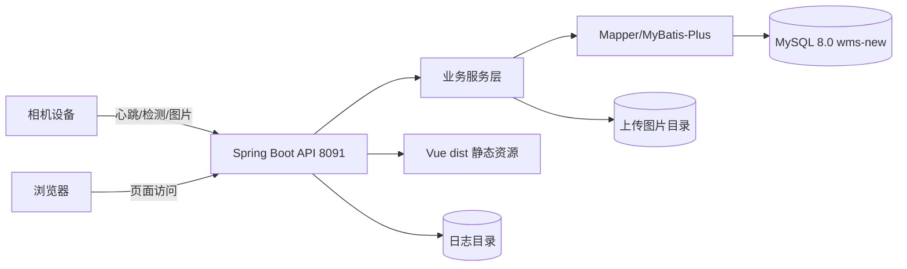
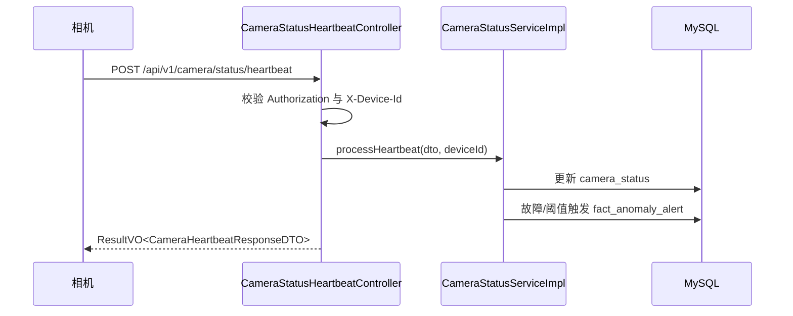
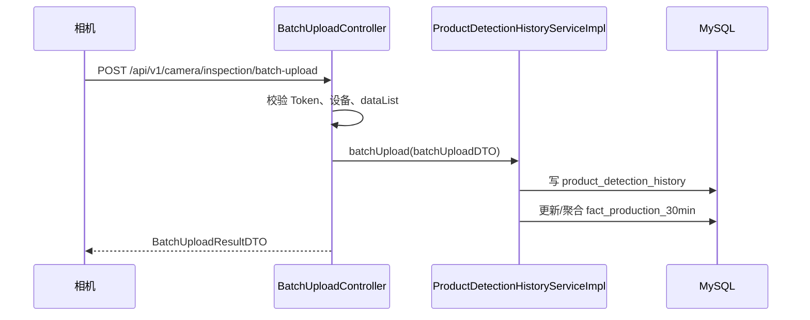
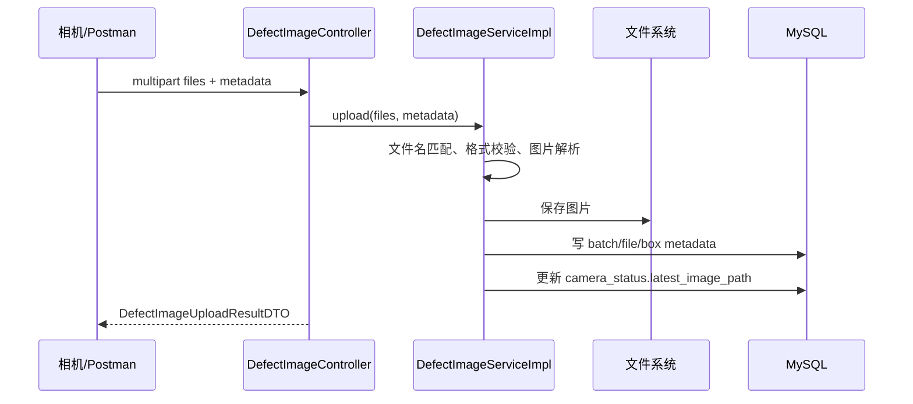

# 研发架构设计文档

## 1. 架构目标

相机检测系统采用单机部署架构，目标是在 Windows 工控机或服务器上运行一个 Spring Boot 服务，同时提供：

- Vue 前端静态页面。
- 相机状态/检测/图片上报 API。
- 业务配置与统计查询 API。
- 图片文件访问服务。
- Windows 服务自启动能力。

## 2. 逻辑架构



## 3. 部署架构

```text
Windows 电脑
├─ MySQL 8.0
│  └─ 数据库：wms-new
│
└─ 相机检测系统 Windows 服务
   ├─ Spring Boot 后端
   ├─ Vue 前端静态页面
   ├─ 图片上传目录
   ├─ 日志目录
   ├─ 外部配置 application.yml
   └─ 内置 JRE
```

端口：

- `TCP 8091`：页面访问 + 相机接口上报。
- `TCP 3306`：仅本机 MySQL 使用，默认不对外开放。

## 4. 技术分层

### 4.1 前端层

- Vue 3 + Vue Router + Pinia。
- Element Plus 组件库。
- ECharts 图表。
- Axios 请求封装，`baseURL=/api`。
- 构建产物由 Vite 输出到 `frontend/dist`。
- 发布时复制进 Spring Boot `static`。

### 4.2 后端接口层

- Spring Boot Web Controller。
- REST 风格接口。
- 统一响应对象：`ResultVO`。
- JWT 请求过滤器：`JwtRequestFilter`。
- 操作日志 AOP：`OperationLogAspect`。
- Vue history fallback：`SpaFallbackController`。

### 4.3 业务服务层

- `CameraStatusServiceImpl`：心跳、状态、资源告警。
- `ProductDetectionHistoryServiceImpl`：检测记录、产量/良率聚合。
- `DefectImageServiceImpl`：缺陷图片批量上传、metadata 落库、图片读取。
- 其他配置与统计 Service 负责维表、分页、统计计算。

### 4.4 数据访问层

- MyBatis-Plus Mapper。
- XML Mapper 用于复杂 SQL 查询。
- 数据源：Druid 连接池。
- 数据库：MySQL 8.0。

### 4.5 文件存储层

- 缺陷图片目录：`${app.home}/data/uploads/defect-images/`。
- 兼容图片目录：`${app.home}/data/uploads/images`。
- 日志目录：`${app.home}/logs/camera-detection-system.log`。
- 安装包运行时通过 `-Dapp.home=<安装目录>` 指定根路径。

## 5. 关键业务数据流

### 5.1 相机心跳流



### 5.2 检测批量上报流



### 5.3 缺陷图片上传流



## 6. 前端架构

### 6.1 路由结构

- `/login`、`/register`：公开页面。
- `/`：Layout 布局，默认跳转 `/camera-status`。
- `/camera-status`：相机状态，默认入口。
- `/dashboard`：产线总览。
- `/stats/defects`：缺陷统计。
- `/stats/yield`：良率分析。
- `/stats/images`：图像记录。
- `/system/config`：系统配置。

### 6.2 状态管理

- Token：`src/utils/auth.js`。
- 用户状态：`src/stores/user.js`。
- 全局筛选：`Layout.vue` 通过 provide/inject 注入筛选条件。

### 6.3 组件复用

- `CameraImageRecords.vue` 被图像记录和相机状态复用。
- `EmptyState.vue` 统一空状态/异常状态/加载状态。
- 图表组件封装在 `components` 和 `views/stats` 中。

## 7. 后端架构

### 7.1 Controller 分组

- 认证：`AuthController`、`SysUserController`。
- 相机：`CameraDashboardController`、`CameraStatusHeartbeatController`、`CameraImageController`。
- 缺陷图片：`DefectImageController`。
- 检测记录：`BatchUploadController`、`ProductDetectionHistoryController`。
- 统计：`StatsController`。
- 配置：工厂、产线、工位、配置导入。
- 系统：节假日、操作日志。

### 7.2 统一返回

接口统一返回 `ResultVO<T>`：

```json
{
  "code": 200,
  "message": "操作成功",
  "data": {}
}
```

失败返回 `code != 200` 或 `message` 指示错误原因。

## 8. 数据架构

核心表分为：

- 维度表：公司、工厂、产线、工位、产品品牌、班次、时间桶、缺陷分类。
- 相机状态表：`camera_status`。
- 检测事实表：`product_detection_history`、`fact_production_30min`。
- 图片事实表：`defect_image_batch`、`defect_image_file`、`defect_image_box`。
- 告警表：`fact_anomaly_alert`。
- 系统表：`sys_user`、`sys_operation_log`、`sys_holiday_config`。

## 9. 发布架构

一键构建脚本：`build-release.ps1`。

构建步骤：

1. 执行前端 `npm run build`。
2. 将 `frontend/dist` 复制进后端 `static`。
3. 执行 Maven `clean package`。
4. 生成发布目录。
5. 编译 Windows 服务包装器。
6. 可选复制 JRE。
7. 调用 Inno Setup 生成安装 exe。

最终安装包：

```text
D:\45344\0004-软件源码\dist-release\installer\CameraDetectionSystem-Setup-1.0.0.exe
```

## 10. 扩展设计建议

- P1：补齐设备 Token 管理表，替代当前仅校验 Bearer 前缀。
- P1：相机状态与相机配置拆表，降低状态写入对配置管理的影响。
- P1：统计接口增加缓存和统一分页。
- P2：Excel 导出、数据归档、后台清理配置页。
- P2：多工厂部署和远程 MySQL 安全访问策略。
