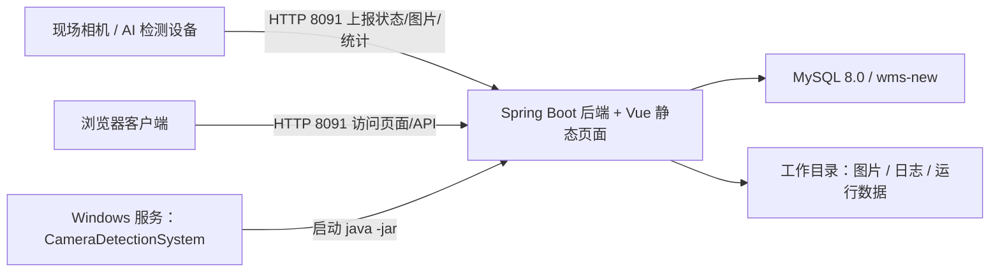
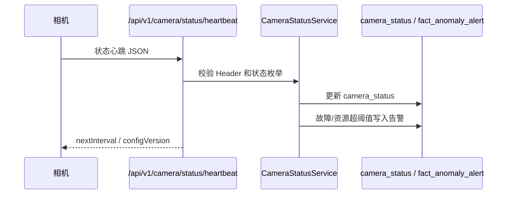
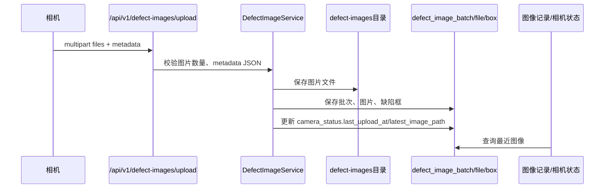
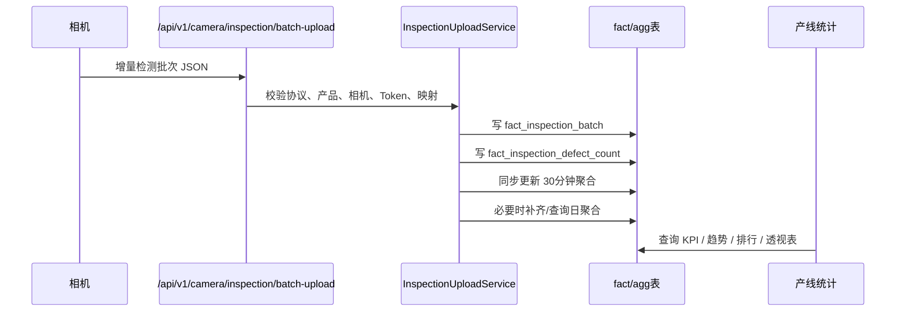
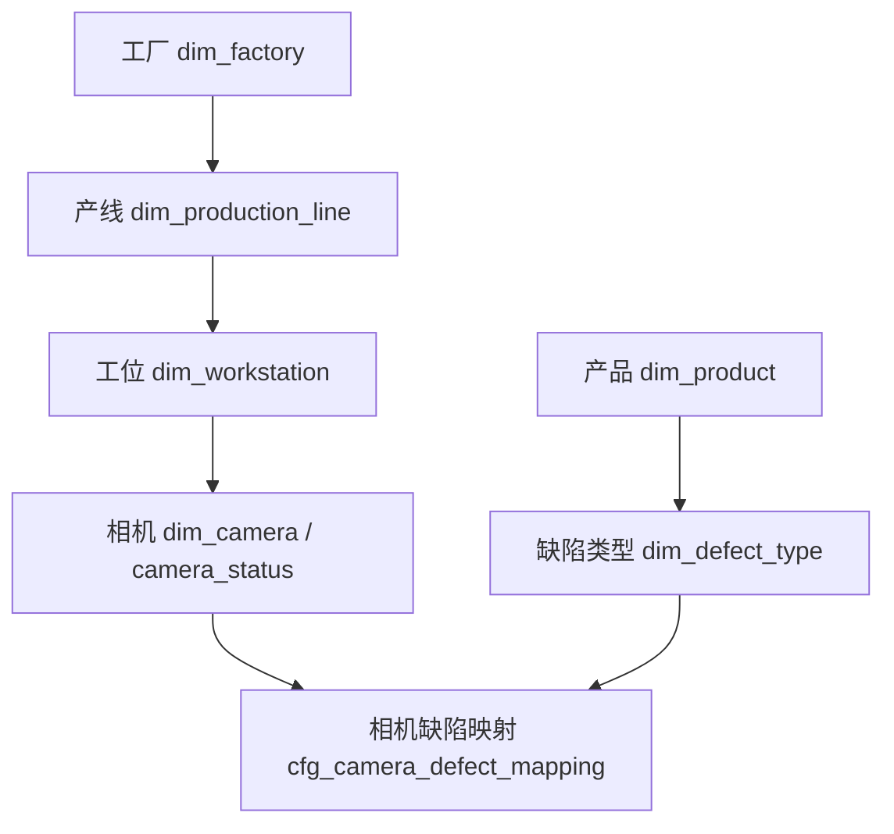

# 产线缺陷在线AI检测系统 — 项目详细说明文档

版本：v1.0  
日期：2026-06-14  
依据：当前 `D:\45344\0004-软件源码` 前端、后端、安装包与专项回归结果

---

## 1. 项目定位

本项目是面向工厂产线的本地化相机 AI 缺陷检测平台，核心目标是：

1. 接收现场相机上报的实时状态、资源指标和故障信息。
2. 接收相机上传的缺陷图片和缺陷框 metadata。
3. 接收相机上报的增量检测统计数据，按产线、工位、相机、产品、班次、缺陷类型等维度汇总。
4. 在浏览器页面中展示相机状态、图像记录、产线统计报表。
5. 在系统配置中维护工厂、产线、工位、相机、产品、缺陷类型、相机缺陷映射、用户、操作日志等基础数据。
6. 支持 Windows 安装包交付，安装后以 Windows 服务方式启动，端口统一为 `8091`。

系统名称：**产线缺陷在线AI检测系统**。

---

## 2. 当前交付范围

### 2.1 主页面 Tab

当前主界面顶部仅保留 3 个主 Tab：

| 顺序 | Tab | 路由 | 说明 |
|---:|---|---|---|
| 1 | 相机状态 | `/camera-status` | 默认首页，展示相机运行状态、上传状态、资源指标、最近缺陷图聚合 |
| 2 | 图像记录 | `/stats/images` | 按相机一行聚合展示缺陷图片、历史记录、缺陷框详情 |
| 3 | 产线统计 | `/line-analytics` | 动态配置报表、统计看板、图表导出、日聚合任务 |

顶部固定区域包含：

- 系统标题
- 当前班次展示
- 工厂 / 产线 / 工位级联筛选
- 刷新配置按钮
- 系统配置入口
- 当前登录用户展示：角色 + 用户名

### 2.2 系统配置入口

系统配置页面路由：

- `/system/config`
- 旧路由 `/system-config` 自动重定向到 `/system/config`

系统配置聚合维护以下能力：

| 模块 | 当前能力 |
---|---|
| 配置总览 | 展示工厂、产线、工位、相机数量 |
| 产线层级 | 工厂、产线、工位、相机的层级配置 |
| 工厂管理 | 新增、编辑、删除依赖校验、分页 |
| 产线管理 | 新增、编辑、删除依赖校验、分页 |
| 工位管理 | 新增、编辑、删除依赖校验、分页 |
| 相机管理 | 新增、编辑、删除依赖校验、分页 |
| 产品管理 | 产品编码、名称、规格、品牌等维护 |
| 缺陷类型 | 按产品维护缺陷编码、名称、严重度等 |
| 相机缺陷映射 | 将设备上报 `sourceCode` 1:1 映射到标准缺陷类型 |
| 映射异常 | 查询未映射编码、产品未配置等异常 |
| 用户管理 | 管理员、普通用户维护 |
| 操作日志 | 查询、详情、导出、删除、清空日志 |
| 系统设置 | 告警阈值、数据清理等系统参数 |
| 整体配置导入 | 支持工厂、产线、工位、相机整体导入配置 |

---

## 3. 技术架构

### 3.1 总体架构



### 3.2 前端技术栈

依据 `frontend/package.json`：

| 技术 | 当前版本/说明 |
---|---|
| Vue | `^3.5.34` |
| Vite | `^5.2.0` |
| Vue Router | `^4.6.4` |
| Pinia | `^3.0.4` |
| Element Plus | `^2.7.0` |
| ECharts | `^5.6.0` |
| Axios | `^1.16.1` |

前端构建后集成到 Spring Boot：

- 源码目录：`D:\45344\0004-软件源码\frontend`
- 构建产物：`frontend\dist`
- 后端静态目录：`fact-product\src\main\resources\static`
- 访问端口：`8091`

### 3.3 后端技术栈

| 技术 | 说明 |
---|---|
| Java | JDK/JRE 8+ |
| Spring Boot | 2.7.x |
| MyBatis Plus | 实体和分页查询 |
| JdbcTemplate | 动态统计、配置、聚合类 SQL |
| MySQL Connector/J | MySQL 8 连接 |
| Druid | 数据库连接池 |
| Spring Security + JWT | 登录、Token、前端用户态 |
| Apache POI | 图表 Excel 导出 |
| C# Windows Service Wrapper | 包装 Spring Boot Jar 为 Windows 服务 |

### 3.4 安装包技术

| 组件 | 说明 |
---|---|
| Inno Setup | 生成 Windows 安装包 |
| Windows Service | 服务名称 `CameraDetectionSystem` |
| 内置 JRE | 安装包包含 `jre\bin\java.exe`，避免目标机器缺 Java |
| 外部配置 | `config\application.yml` |
| 工作路径 | 安装时选择，用于保存日志、图片、运行数据 |

---

## 4. 当前核心数据流

### 4.1 配置数据流

1. 管理员在系统配置页面维护：
   - 工厂
   - 产线
   - 工位
   - 相机
   - 产品
   - 缺陷类型
   - 相机缺陷映射
2. 相机所属工厂、产线、工位只允许由系统配置维护。
3. 相机上报心跳时只更新实时状态、资源指标和计数，不修改所属关系。
4. 前端顶部级联筛选通过 `/api/cascade/all` 获取配置树。

### 4.2 相机状态上报数据流



状态枚举：

| code | 存储枚举 | 中文 |
---:|---|---|
| 0 | `STOPPED` | 停止 |
| 1 | `RUNNING` | 运行 |
| 2 | `FAULT` | 故障 |
| 3 | `STANDBY` | 待机 |
| 9 | `OFFLINE` | 离线，由服务端/页面按超时派生 |

告警阈值：

| 类型 | 规则 | 告警等级 |
---|---|---|
| 相机故障 | `cameraStatus=2` | `CRITICAL` |
| CPU | `cpuUsage > 90` | `WARNING` |
| 内存 | `memoryUsage > 90` | `WARNING` |
| 温度 | `temperature > 70℃` | `WARNING` |
| 计数异常 | `recognizeCount != correctCount + abnormalCount` 且差值大于 1 | `WARNING` |

### 4.3 缺陷图片上传数据流



当前最大单批图片数量：**100 张**。

### 4.4 批量检测统计上报数据流



关键规则：

- 当前只支持 `counterMode=INCREMENTAL`。
- 产品名称 `productName` 必须能匹配 `dim_product.product_name`。
- 相机编码 `cameraCode` 或 `X-Device-Id` 必须能匹配 `dim_camera.camera_code/device_id`。
- 缺陷上报编码 `sourceCode` 必须在 `cfg_camera_defect_mapping` 中按“相机 + 产品 + sourceCode”配置一对一映射。
- 未映射编码返回 HTTP 422，并写入映射异常表。
- 30 分钟聚合为同步写入；大时间范围查询自动走日聚合。

---

## 5. 页面功能说明

### 5.1 登录与权限

默认登录页：

- `/login`

当前实现：

- 管理员账号可进入系统配置。
- 普通用户不允许进入需要管理员权限的配置页面，会跳回 `/camera-status`。
- 顶部右侧展示当前用户角色和用户名，例如：`系统管理员 · admin`。

说明：

- 前端路由守卫基于本地 Token 和用户角色判断页面访问。
- 后端当前为了设备上报和本地部署联调，多个 API 处于放行状态；生产部署如需更强权限控制，应在后端 SecurityConfig 中进一步收紧管理类接口。

### 5.2 相机状态页

路由：

- `/camera-status`

核心能力：

| 功能 | 说明 |
---|---|
| KPI | 相机总数、运行中、上传延迟/离线、故障/离线、近批次图片、高危缺陷 |
| 搜索 | 支持相机名称、相机编号、工位、产品、故障信息 |
| 状态筛选 | 全部、运行、停止、故障、待机、离线 |
| 上传状态筛选 | 根据最后上传时间派生在线/延迟/离线 |
| 异常优先 | 默认关闭；开启后故障、资源异常、上传异常优先 |
| 表格分页 | 默认 10 条，支持页大小切换 |
| 最近图像 | 聚合每台相机最近缺陷图，复用图像记录能力 |
| 解析失败提示 | 图片加载失败时展示失败原因和处理建议 |

表头当前重点字段：

1. 相机名称
2. 工位名称
3. 相机编号
4. 当前检测产品
5. 检测总数
6. OK数
7. 缺陷数
8. 运行状态
9. 心跳状态
10. 上传状态
11. CPU
12. 内存
13. 温度
14. 最近上传
15. 最近缺陷图

### 5.3 图像记录页

路由：

- `/stats/images`

核心能力：

| 功能 | 说明 |
---|---|
| 相机聚合 | 一行展示一个相机对象 |
| 搜索 | 支持搜索相机、设备编号、工位、文件名 |
| 缩略图 | 展示最近 5 张有效缺陷图 |
| 历史记录 | 单相机展开后展示历史图片表格 |
| 分页 | 历史图片支持分页切换 |
| 图片预览 | 点击图片弹窗展示大图 |
| 左右切换 | 弹窗内支持上一张 / 下一张 |
| 缺陷框 metadata | 展示缺陷类型、严重度、坐标、面积 |
| 失败提示 | 图片加载失败时展示文件名、失败原因、处理建议 |

### 5.4 产线统计页

路由：

- `/line-analytics`

核心能力：

| 功能 | 说明 |
---|---|
| 全局筛选 | 时间、产品、班次、相机、缺陷类型、严重度 |
| KPI | 检测总数、OK数、NG数、良率等 |
| 趋势图 | 折线图展示产量、NG、良率趋势 |
| 缺陷排行 | 按缺陷类型、严重度统计 |
| 工位排行 | 按工位展示 NG、良率、产量 |
| 相机排行 | 按相机展示 NG、良率、产量 |
| 动态报表 | 新建/编辑/删除图表组件 |
| 拖拽和缩放 | 图表布局支持保存 |
| 图表导出 | 支持 Excel 导出 |
| 看板模板 | 默认模板、新建模板、复制、另存为、删除 |
| 大屏展示 | 默认统计看板支持大屏展示 |
| 日聚合 | 支持手动聚合、夜间自动聚合、任务列表、失败重试 |

聚合策略：

- 小范围查询：使用 `agg_quality_30m`、`agg_defect_type_30m`。
- 大范围查询：超过阈值时使用 `agg_quality_day`、`agg_defect_type_day`。
- 当前代码阈值：`DAILY_AGGREGATION_THRESHOLD_DAYS = 3`。

### 5.5 系统配置页

路由：

- `/system/config`

配置对象层级：



删除策略：

- 存在下级依赖或历史数据时，不允许直接删除。
- 建议先停用、归档或清理历史，再删除。
- 缺陷映射删除当前实现为停用映射，而不是物理删除。

---

## 6. 数据库模型概览

### 6.1 基础配置表

| 表 | 说明 |
---|---|
| `dim_factory` | 工厂 |
| `dim_production_line` | 产线 |
| `dim_workstation` | 工位 |
| `dim_camera` | 相机配置，包含所属工厂、产线、工位 |
| `camera_status` | 相机实时状态和累计计数 |
| `dim_product` | 产品 |
| `dim_defect_type` | 标准缺陷类型 |
| `cfg_camera_defect_mapping` | 相机上报编码到标准缺陷类型的映射 |
| `cfg_camera_token` | 相机上报 Token 配置 |
| `sys_user` | 用户 |
| `sys_operation_log` | 操作日志 |
| `system_settings` | 系统设置 |

### 6.2 图片表

| 表 | 说明 |
---|---|
| `defect_image_batch` | 缺陷图片上传批次 |
| `defect_image_file` | 缺陷图片文件记录 |
| `defect_image_box` | 缺陷框 metadata |

### 6.3 检测统计表

| 表 | 说明 |
---|---|
| `fact_inspection_batch` | 检测上报批次事实 |
| `fact_inspection_defect_count` | 每个缺陷编码映射后的计数事实 |
| `fact_inspection_mapping_exception` | 产品、相机、缺陷映射异常 |
| `agg_quality_30m` | 30 分钟质量聚合 |
| `agg_defect_type_30m` | 30 分钟缺陷类型聚合 |
| `agg_quality_day` | 日质量聚合 |
| `agg_defect_type_day` | 日缺陷类型聚合 |

### 6.4 报表配置表

| 表 | 说明 |
---|---|
| `cfg_analytics_dashboard` | 看板模板 |
| `cfg_analytics_widget` | 图表组件配置 |
| `analytics_aggregation_schedule` | 日聚合定时配置 |
| `analytics_aggregation_job` | 聚合任务记录 |

---

## 7. 部署形态

### 7.1 安装包目录结构

安装后典型结构：

```text
CameraDetectionSystem
├─ app
│  └─ time-bucket-demo.jar
├─ config
│  ├─ application.yml
│  └─ workdir.txt
├─ service
│  └─ CameraDetectionService.exe
├─ jre
│  └─ bin/java.exe
├─ scripts
│  ├─ init-database.ps1
│  ├─ install-service.ps1
│  ├─ start-service.ps1
│  ├─ stop-service.ps1
│  ├─ service-status.ps1
│  ├─ uninstall-service.ps1
│  └─ verify-installation.ps1
├─ sql
│  └─ wms-new.sql
├─ docs
└─ README.txt
```

工作路径用于保存：

```text
工作路径
├─ logs
│  ├─ camera-detection-system.log
│  ├─ service-wrapper.log
│  ├─ service-out.log
│  └─ service-err.log
└─ data
   └─ uploads
      ├─ defect-images
      └─ images
```

### 7.2 端口

| 端口 | 用途 | 建议 |
---:|---|---|
| 8091 | 页面访问 + 相机接口上报 | 按现场相机网络需要开放 |
| 3306 | 本机 MySQL | 默认仅本机使用，不建议对外开放 |

---

## 8. 已验证结果

最新专项回归与安装包端到端验收：

- 报告：`D:\45344\0004-软件源码\test-reports\专项回归与安装包端到端验收报告-latest.md`
- 总用例：48
- 通过：48
- 失败：0
- P0 未通过：0
- 通过率：100%

覆盖模块：

| 模块 | 覆盖 |
---|---|
| 相机状态页 | 心跳、状态筛选、搜索、告警、排序、分页 |
| 图像记录页 | 多图上传、严重度、搜索、图片访问、异常提示、100 张边界 |
| 产线统计 | 检测上报、30分钟聚合、日聚合、图表新增/编辑/删除、导出 |
| 安装包 | EXE、JRE、服务、MySQL、8091 页面和上报接口 |

---

## 9. 已知注意事项

1. **设备接入优先使用 3 个新版接口**：心跳、检测统计、缺陷图片上传。
2. **相机所属关系不从心跳或统计上报中修改**，必须在系统配置中维护。
3. **检测统计只支持增量计数**，不支持累计计数自动差分。
4. **缺陷映射必须一对一配置**，未映射直接返回 422 并记录异常。
5. **图片上传文件名必须和 metadata 完全一致**，包括扩展名。
6. **单批图片最多 100 张**，超过需拆分批次。
7. **后端当前对部分管理接口仍有本地部署放行配置**，如部署到更大网络，建议补充后端接口权限策略。
