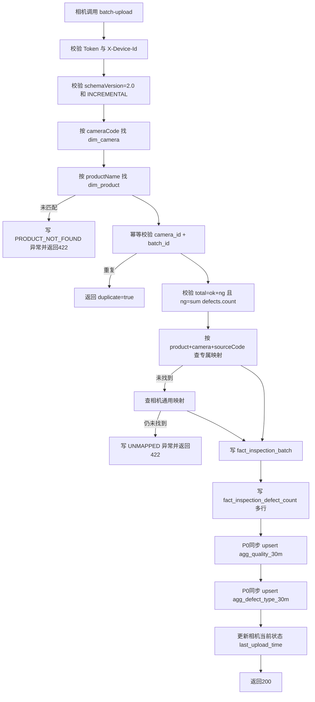
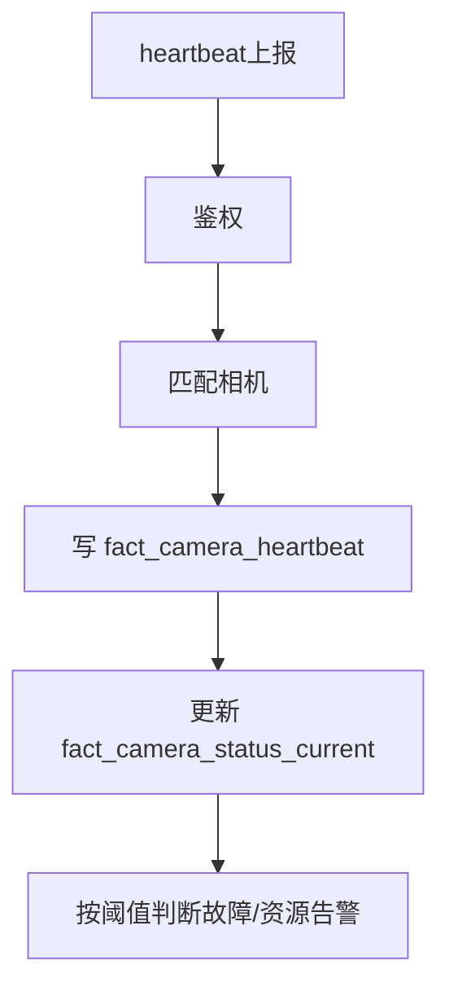

# 最终版开发设计方案：缺陷映射、检测上报与动态报表

版本：v1.0 Final  
日期：2026-06-08  
系统：产线缺陷在线AI检测系统  
状态：已确认，进入 P0 开发实施

---

## 1. 最终确认结论

| 事项 | 最终结论 |
|---|---|
| 旧表处理 | 旧表可废弃，P0 不迁移旧数据，仅备份 |
| 表结构策略 | 直接设计最终表结构，不复用旧的不合理字段 |
| P0 计数模式 | 只支持 `INCREMENTAL` 增量计数 |
| 未映射编码 | 返回 `422`，记录映射异常 |
| 聚合策略 | P0 同步聚合，P1 异步聚合 |
| 产品缺陷 | 支持产品专属缺陷类型，支持 15 种及更多缺陷项 |
| 映射粒度 | `产品 + 相机 + sourceCode`，产品专属优先，通用映射兜底 |
| 动态报表 | 首期按文档执行：KPI、折线、柱状、堆叠柱、排行、透视表 |

---

## 2. 最终建设目标

1. 相机协议稳定：设备只上报产品、相机、批次、汇总计数、`defects[]`。
2. 缺陷灵活配置：产品 A 有 15 种缺陷时，保存为 15 条配置，不新增 15 个字段。
3. 映射精确可控：`产品 + 相机 + p0/p1/p14` 精确映射到标准缺陷类型。
4. 数据可追溯：保存批次、原始 JSON、映射快照、异常记录。
5. 查询高效：页面统计优先查 30 分钟聚合表，明细只用于钻取。
6. 报表可配置：产线统计支持新增图表、配置维度、保存布局。

---

## 3. 数据库分层与命名

| 层级 | 前缀 | 表 |
|---|---|---|
| 维度层 | `dim_` | 工厂、产线、工位、相机、产品、班次、缺陷位置、缺陷类型 |
| 配置层 | `cfg_` | 相机 Token、相机缺陷映射、动态看板、图表组件 |
| 事实层 | `fact_` | 心跳、当前状态、检测批次、缺陷计数、映射异常、图片批次/文件/框 |
| 聚合层 | `agg_` | 质量 30 分钟聚合、缺陷类型 30 分钟聚合、日聚合 |
| 系统层 | `sys_` | 用户、操作日志、数据保留策略 |

---

## 4. 旧表废弃清单

| 旧表 | 最终处理 | 替代表 |
|---|---|---|
| `product_detection_history` | 废弃 | `fact_inspection_batch`、`fact_inspection_defect_count` |
| `camera_status` | 废弃 | `dim_camera`、`fact_camera_heartbeat`、`fact_camera_status_current` |
| `defect_image_batch` | 废弃重建 | `fact_defect_image_batch` |
| `defect_image_file` | 废弃重建 | `fact_defect_image_file` |
| `defect_image_box` | 废弃重建 | `fact_defect_image_box` |
| 旧 `dim_defect_type` | 备份后重建 | 新 `dim_defect_type` |
| 旧临时聚合表 | 废弃 | `agg_quality_30m`、`agg_defect_type_30m` |

实施要求：删除或重建前必须备份数据库，P0 不做旧数据迁移。

---

## 5. 最终表结构设计

### 5.1 `dim_factory` 工厂维度表

```sql
CREATE TABLE dim_factory (
  factory_id BIGINT PRIMARY KEY AUTO_INCREMENT,
  factory_code VARCHAR(50) NOT NULL,
  factory_name VARCHAR(100) NOT NULL,
  address VARCHAR(255) NULL,
  sort_order INT NOT NULL DEFAULT 0,
  is_enabled TINYINT NOT NULL DEFAULT 1,
  is_deleted TINYINT NOT NULL DEFAULT 0,
  create_time DATETIME NOT NULL DEFAULT CURRENT_TIMESTAMP,
  update_time DATETIME NOT NULL DEFAULT CURRENT_TIMESTAMP ON UPDATE CURRENT_TIMESTAMP,
  UNIQUE KEY uk_factory_code (factory_code)
) ENGINE=InnoDB DEFAULT CHARSET=utf8mb4 COMMENT='工厂维度表';
```

### 5.2 `dim_production_line` 产线维度表

```sql
CREATE TABLE dim_production_line (
  line_id BIGINT PRIMARY KEY AUTO_INCREMENT,
  factory_id BIGINT NOT NULL,
  line_code VARCHAR(50) NOT NULL,
  line_name VARCHAR(100) NOT NULL,
  description VARCHAR(500) NULL,
  sort_order INT NOT NULL DEFAULT 0,
  is_enabled TINYINT NOT NULL DEFAULT 1,
  is_deleted TINYINT NOT NULL DEFAULT 0,
  create_time DATETIME NOT NULL DEFAULT CURRENT_TIMESTAMP,
  update_time DATETIME NOT NULL DEFAULT CURRENT_TIMESTAMP ON UPDATE CURRENT_TIMESTAMP,
  UNIQUE KEY uk_factory_line_code (factory_id, line_code),
  KEY idx_factory (factory_id)
) ENGINE=InnoDB DEFAULT CHARSET=utf8mb4 COMMENT='产线维度表';
```

### 5.3 `dim_workstation` 工位维度表

```sql
CREATE TABLE dim_workstation (
  workstation_id BIGINT PRIMARY KEY AUTO_INCREMENT,
  factory_id BIGINT NOT NULL,
  line_id BIGINT NOT NULL,
  workstation_code VARCHAR(50) NOT NULL,
  workstation_name VARCHAR(100) NOT NULL,
  description VARCHAR(500) NULL,
  sort_order INT NOT NULL DEFAULT 0,
  is_enabled TINYINT NOT NULL DEFAULT 1,
  is_deleted TINYINT NOT NULL DEFAULT 0,
  create_time DATETIME NOT NULL DEFAULT CURRENT_TIMESTAMP,
  update_time DATETIME NOT NULL DEFAULT CURRENT_TIMESTAMP ON UPDATE CURRENT_TIMESTAMP,
  UNIQUE KEY uk_line_workstation_code (line_id, workstation_code),
  KEY idx_factory_line (factory_id, line_id)
) ENGINE=InnoDB DEFAULT CHARSET=utf8mb4 COMMENT='工位维度表';
```

### 5.4 `dim_camera` 相机维度表

只保存相机配置，不保存实时状态。

```sql
CREATE TABLE dim_camera (
  camera_id BIGINT PRIMARY KEY AUTO_INCREMENT,
  factory_id BIGINT NOT NULL,
  line_id BIGINT NOT NULL,
  workstation_id BIGINT NOT NULL,
  camera_code VARCHAR(50) NOT NULL,
  camera_name VARCHAR(100) NOT NULL,
  device_id VARCHAR(100) NULL,
  ip_address VARCHAR(64) NULL,
  vendor VARCHAR(100) NULL,
  model VARCHAR(100) NULL,
  install_position VARCHAR(100) NULL,
  description VARCHAR(500) NULL,
  sort_order INT NOT NULL DEFAULT 0,
  is_enabled TINYINT NOT NULL DEFAULT 1,
  is_deleted TINYINT NOT NULL DEFAULT 0,
  create_time DATETIME NOT NULL DEFAULT CURRENT_TIMESTAMP,
  update_time DATETIME NOT NULL DEFAULT CURRENT_TIMESTAMP ON UPDATE CURRENT_TIMESTAMP,
  UNIQUE KEY uk_camera_code (camera_code),
  UNIQUE KEY uk_device_id (device_id),
  KEY idx_scope (factory_id, line_id, workstation_id)
) ENGINE=InnoDB DEFAULT CHARSET=utf8mb4 COMMENT='相机维度表';
```

### 5.5 `dim_product` 产品维度表

```sql
CREATE TABLE dim_product (
  product_id BIGINT PRIMARY KEY AUTO_INCREMENT,
  product_code VARCHAR(50) NOT NULL,
  product_name VARCHAR(100) NOT NULL,
  product_spec VARCHAR(100) NULL,
  brand_name VARCHAR(100) NULL,
  description VARCHAR(500) NULL,
  sort_order INT NOT NULL DEFAULT 0,
  is_enabled TINYINT NOT NULL DEFAULT 1,
  is_deleted TINYINT NOT NULL DEFAULT 0,
  create_time DATETIME NOT NULL DEFAULT CURRENT_TIMESTAMP,
  update_time DATETIME NOT NULL DEFAULT CURRENT_TIMESTAMP ON UPDATE CURRENT_TIMESTAMP,
  UNIQUE KEY uk_product_code (product_code),
  UNIQUE KEY uk_product_name (product_name)
) ENGINE=InnoDB DEFAULT CHARSET=utf8mb4 COMMENT='产品维度表';
```

### 5.6 `dim_shift` 班次维度表

```sql
CREATE TABLE dim_shift (
  shift_id BIGINT PRIMARY KEY AUTO_INCREMENT,
  shift_code VARCHAR(50) NOT NULL,
  shift_name VARCHAR(100) NOT NULL,
  start_time TIME NOT NULL,
  end_time TIME NOT NULL,
  cross_day TINYINT NOT NULL DEFAULT 0,
  is_enabled TINYINT NOT NULL DEFAULT 1,
  create_time DATETIME NOT NULL DEFAULT CURRENT_TIMESTAMP,
  update_time DATETIME NOT NULL DEFAULT CURRENT_TIMESTAMP ON UPDATE CURRENT_TIMESTAMP,
  UNIQUE KEY uk_shift_code (shift_code)
) ENGINE=InnoDB DEFAULT CHARSET=utf8mb4 COMMENT='班次维度表';
```

### 5.7 `dim_defect_position` 缺陷位置维度表

```sql
CREATE TABLE dim_defect_position (
  position_id BIGINT PRIMARY KEY AUTO_INCREMENT,
  position_code VARCHAR(50) NOT NULL,
  position_name VARCHAR(100) NOT NULL,
  description VARCHAR(500) NULL,
  sort_order INT NOT NULL DEFAULT 0,
  is_enabled TINYINT NOT NULL DEFAULT 1,
  is_deleted TINYINT NOT NULL DEFAULT 0,
  create_time DATETIME NOT NULL DEFAULT CURRENT_TIMESTAMP,
  update_time DATETIME NOT NULL DEFAULT CURRENT_TIMESTAMP ON UPDATE CURRENT_TIMESTAMP,
  UNIQUE KEY uk_position_code (position_code)
) ENGINE=InnoDB DEFAULT CHARSET=utf8mb4 COMMENT='缺陷位置维度表';
```

### 5.8 `dim_defect_type` 缺陷类型维度表

支持产品专属缺陷。`product_id` 为空表示通用缺陷，不为空表示某产品专属缺陷。

```sql
CREATE TABLE dim_defect_type (
  defect_type_id BIGINT PRIMARY KEY AUTO_INCREMENT,
  product_id BIGINT NULL,
  defect_code VARCHAR(50) NOT NULL,
  defect_name VARCHAR(100) NOT NULL,
  defect_category VARCHAR(50) NULL,
  default_position_id BIGINT NULL,
  default_position_code VARCHAR(50) NULL,
  default_position_name VARCHAR(100) NULL,
  default_severity VARCHAR(20) NOT NULL DEFAULT 'MEDIUM',
  is_ng TINYINT NOT NULL DEFAULT 1,
  description VARCHAR(500) NULL,
  sort_order INT NOT NULL DEFAULT 0,
  is_enabled TINYINT NOT NULL DEFAULT 1,
  is_deleted TINYINT NOT NULL DEFAULT 0,
  create_time DATETIME NOT NULL DEFAULT CURRENT_TIMESTAMP,
  update_time DATETIME NOT NULL DEFAULT CURRENT_TIMESTAMP ON UPDATE CURRENT_TIMESTAMP,
  UNIQUE KEY uk_product_defect_code (product_id, defect_code),
  KEY idx_product (product_id),
  KEY idx_position (default_position_id),
  KEY idx_severity (default_severity)
) ENGINE=InnoDB DEFAULT CHARSET=utf8mb4 COMMENT='缺陷类型维度表';
```

产品 A 有 15 种缺陷时，在该表中保存 15 行，而不是 15 个字段。

### 5.9 `cfg_camera_defect_mapping` 相机缺陷映射配置表

最终映射粒度：`产品 + 相机 + sourceCode`。`product_id` 为空表示相机通用映射；产品专属映射优先。

```sql
CREATE TABLE cfg_camera_defect_mapping (
  mapping_id BIGINT PRIMARY KEY AUTO_INCREMENT,
  factory_id BIGINT NOT NULL,
  line_id BIGINT NOT NULL,
  workstation_id BIGINT NOT NULL,
  camera_id BIGINT NOT NULL,
  camera_code VARCHAR(50) NOT NULL,
  product_id BIGINT NULL,
  product_name VARCHAR(100) NULL,
  source_code VARCHAR(50) NOT NULL,
  defect_type_id BIGINT NOT NULL,
  defect_code VARCHAR(50) NOT NULL,
  defect_name VARCHAR(100) NOT NULL,
  position_id BIGINT NULL,
  position_code VARCHAR(50) NULL,
  position_name VARCHAR(100) NULL,
  severity VARCHAR(20) NOT NULL DEFAULT 'MEDIUM',
  is_ng TINYINT NOT NULL DEFAULT 1,
  is_enabled TINYINT NOT NULL DEFAULT 1,
  effective_start DATETIME NOT NULL,
  effective_end DATETIME NULL,
  create_by BIGINT NULL,
  update_by BIGINT NULL,
  create_time DATETIME NOT NULL DEFAULT CURRENT_TIMESTAMP,
  update_time DATETIME NOT NULL DEFAULT CURRENT_TIMESTAMP ON UPDATE CURRENT_TIMESTAMP,
  UNIQUE KEY uk_camera_product_source_start (camera_id, product_id, source_code, effective_start),
  KEY idx_camera_product_source_time (camera_id, product_id, source_code, effective_start, effective_end),
  KEY idx_camera_product_defect_time (camera_id, product_id, defect_type_id, effective_start, effective_end),
  KEY idx_scope (factory_id, line_id, workstation_id, camera_id, product_id),
  KEY idx_enabled (is_enabled)
) ENGINE=InnoDB DEFAULT CHARSET=utf8mb4 COMMENT='相机上报编码与缺陷类型映射配置表';
```

后端必须校验：

1. 同一 `camera_id + product_id + source_code` 生效期不能重叠。
2. 同一 `camera_id + product_id + defect_type_id` 生效期不能重叠。
3. 查询映射时优先产品专属，再查相机通用。
4. 均未命中返回 `422`。

### 5.10 `cfg_camera_token` 相机 Token 配置表

```sql
CREATE TABLE cfg_camera_token (
  token_id BIGINT PRIMARY KEY AUTO_INCREMENT,
  camera_id BIGINT NOT NULL,
  camera_code VARCHAR(50) NOT NULL,
  token_hash VARCHAR(255) NOT NULL,
  token_name VARCHAR(100) NULL,
  expire_time DATETIME NULL,
  is_enabled TINYINT NOT NULL DEFAULT 1,
  create_time DATETIME NOT NULL DEFAULT CURRENT_TIMESTAMP,
  update_time DATETIME NOT NULL DEFAULT CURRENT_TIMESTAMP ON UPDATE CURRENT_TIMESTAMP,
  KEY idx_camera (camera_id),
  KEY idx_enabled_expire (is_enabled, expire_time)
) ENGINE=InnoDB DEFAULT CHARSET=utf8mb4 COMMENT='相机设备上报Token配置表';
```

### 5.11 `fact_camera_heartbeat` 相机心跳事实表

```sql
CREATE TABLE fact_camera_heartbeat (
  heartbeat_id BIGINT PRIMARY KEY AUTO_INCREMENT,
  camera_id BIGINT NOT NULL,
  camera_code VARCHAR(50) NOT NULL,
  product_id BIGINT NULL,
  product_name VARCHAR(100) NULL,
  report_time DATETIME NOT NULL,
  camera_status INT NOT NULL COMMENT '0停止 1运行 2故障 3待机',
  recognize_count BIGINT NOT NULL DEFAULT 0,
  correct_count BIGINT NOT NULL DEFAULT 0,
  abnormal_count BIGINT NOT NULL DEFAULT 0,
  cpu_usage DECIMAL(5,2) NULL,
  memory_usage DECIMAL(5,2) NULL,
  temperature DECIMAL(5,2) NULL,
  error_message VARCHAR(500) NULL,
  raw_json JSON NULL,
  create_time DATETIME NOT NULL DEFAULT CURRENT_TIMESTAMP,
  KEY idx_camera_time (camera_id, report_time),
  KEY idx_status_time (camera_status, report_time),
  KEY idx_product_time (product_id, report_time)
) ENGINE=InnoDB DEFAULT CHARSET=utf8mb4 COMMENT='相机心跳上报事实表';
```

### 5.12 `fact_camera_status_current` 相机当前状态快照表

每台相机一行，用于相机状态页快速查询。

```sql
CREATE TABLE fact_camera_status_current (
  camera_id BIGINT PRIMARY KEY,
  camera_code VARCHAR(50) NOT NULL,
  product_id BIGINT NULL,
  product_name VARCHAR(100) NULL,
  run_status INT NOT NULL DEFAULT 9 COMMENT '0停止 1运行 2故障 3待机 9离线',
  heartbeat_state VARCHAR(20) NOT NULL DEFAULT 'OFFLINE',
  upload_state VARCHAR(20) NOT NULL DEFAULT 'NONE',
  last_heartbeat_time DATETIME NULL,
  last_upload_time DATETIME NULL,
  recognize_count BIGINT NOT NULL DEFAULT 0,
  correct_count BIGINT NOT NULL DEFAULT 0,
  abnormal_count BIGINT NOT NULL DEFAULT 0,
  cpu_usage DECIMAL(5,2) NULL,
  memory_usage DECIMAL(5,2) NULL,
  temperature DECIMAL(5,2) NULL,
  error_message VARCHAR(500) NULL,
  latest_image_url VARCHAR(500) NULL,
  update_time DATETIME NOT NULL DEFAULT CURRENT_TIMESTAMP ON UPDATE CURRENT_TIMESTAMP,
  KEY idx_run_status (run_status),
  KEY idx_heartbeat_state (heartbeat_state),
  KEY idx_upload_state (upload_state),
  KEY idx_last_heartbeat (last_heartbeat_time),
  KEY idx_last_upload (last_upload_time)
) ENGINE=InnoDB DEFAULT CHARSET=utf8mb4 COMMENT='相机当前状态快照表';
```

### 5.13 `fact_inspection_batch` 检测批次事实表

```sql
CREATE TABLE fact_inspection_batch (
  inspection_batch_id BIGINT PRIMARY KEY AUTO_INCREMENT,
  batch_id VARCHAR(100) NOT NULL,
  request_id VARCHAR(100) NULL,
  schema_version VARCHAR(20) NOT NULL DEFAULT '2.0',
  camera_id BIGINT NOT NULL,
  camera_code VARCHAR(50) NOT NULL,
  camera_name VARCHAR(100) NULL,
  product_id BIGINT NOT NULL,
  product_name VARCHAR(100) NOT NULL,
  factory_id BIGINT NOT NULL,
  line_id BIGINT NOT NULL,
  workstation_id BIGINT NOT NULL,
  shift_id BIGINT NULL,
  report_time DATETIME NOT NULL,
  start_time DATETIME NOT NULL,
  end_time DATETIME NOT NULL,
  counter_mode VARCHAR(20) NOT NULL DEFAULT 'INCREMENTAL',
  total_count BIGINT NOT NULL DEFAULT 0,
  ok_count BIGINT NOT NULL DEFAULT 0,
  ng_count BIGINT NOT NULL DEFAULT 0,
  mapped_defect_count BIGINT NOT NULL DEFAULT 0,
  unmapped_defect_count BIGINT NOT NULL DEFAULT 0,
  status VARCHAR(20) NOT NULL DEFAULT 'ACCEPTED',
  error_message VARCHAR(500) NULL,
  raw_json JSON NULL,
  create_time DATETIME NOT NULL DEFAULT CURRENT_TIMESTAMP,
  UNIQUE KEY uk_camera_batch (camera_id, batch_id),
  KEY idx_report_scope (report_time, factory_id, line_id, workstation_id, camera_id),
  KEY idx_product_shift_time (product_id, shift_id, report_time),
  KEY idx_status_time (status, report_time)
) ENGINE=InnoDB DEFAULT CHARSET=utf8mb4 COMMENT='检测批次上报事实表';
```

### 5.14 `fact_inspection_defect_count` 检测缺陷计数事实表

```sql
CREATE TABLE fact_inspection_defect_count (
  defect_count_id BIGINT PRIMARY KEY AUTO_INCREMENT,
  inspection_batch_id BIGINT NOT NULL,
  batch_id VARCHAR(100) NOT NULL,
  camera_id BIGINT NOT NULL,
  camera_code VARCHAR(50) NOT NULL,
  product_id BIGINT NOT NULL,
  product_name VARCHAR(100) NOT NULL,
  factory_id BIGINT NOT NULL,
  line_id BIGINT NOT NULL,
  workstation_id BIGINT NOT NULL,
  shift_id BIGINT NULL,
  report_time DATETIME NOT NULL,
  time_bucket_10m DATETIME NOT NULL,
  time_bucket_30m DATETIME NOT NULL,
  source_code VARCHAR(50) NOT NULL,
  mapping_id BIGINT NOT NULL,
  defect_type_id BIGINT NOT NULL,
  defect_code VARCHAR(50) NOT NULL,
  defect_name VARCHAR(100) NOT NULL,
  position_id BIGINT NULL,
  position_code VARCHAR(50) NULL,
  position_name VARCHAR(100) NULL,
  severity VARCHAR(20) NOT NULL DEFAULT 'MEDIUM',
  defect_count BIGINT NOT NULL DEFAULT 0,
  is_ng TINYINT NOT NULL DEFAULT 1,
  create_time DATETIME NOT NULL DEFAULT CURRENT_TIMESTAMP,
  KEY idx_batch (inspection_batch_id),
  KEY idx_time_line_defect (time_bucket_30m, line_id, defect_type_id),
  KEY idx_time_station_defect (time_bucket_30m, workstation_id, defect_type_id),
  KEY idx_time_camera_defect (time_bucket_30m, camera_id, defect_type_id),
  KEY idx_product_defect_time (product_id, defect_type_id, report_time),
  KEY idx_filter_combo (factory_id, line_id, workstation_id, camera_id, product_id, shift_id, report_time)
) ENGINE=InnoDB DEFAULT CHARSET=utf8mb4 COMMENT='检测缺陷计数事实表';
```

产品 A 上报 15 种缺陷时，该表最多写入 15 行；不上报的缺陷项页面按 0 处理。

### 5.15 `fact_inspection_mapping_exception` 映射异常事实表

```sql
CREATE TABLE fact_inspection_mapping_exception (
  exception_id BIGINT PRIMARY KEY AUTO_INCREMENT,
  batch_id VARCHAR(100) NOT NULL,
  request_id VARCHAR(100) NULL,
  camera_id BIGINT NULL,
  camera_code VARCHAR(50) NOT NULL,
  product_id BIGINT NULL,
  product_name VARCHAR(100) NULL,
  source_code VARCHAR(50) NOT NULL,
  exception_type VARCHAR(50) NOT NULL COMMENT 'UNMAPPED/DUPLICATED/DISABLED/EXPIRED/COUNT_MISMATCH/PRODUCT_NOT_FOUND',
  exception_message VARCHAR(500) NOT NULL,
  suggestion VARCHAR(500) NULL,
  factory_id BIGINT NULL,
  line_id BIGINT NULL,
  workstation_id BIGINT NULL,
  report_time DATETIME NULL,
  status VARCHAR(20) NOT NULL DEFAULT 'OPEN',
  handled_by BIGINT NULL,
  handled_time DATETIME NULL,
  create_time DATETIME NOT NULL DEFAULT CURRENT_TIMESTAMP,
  KEY idx_camera_product_source_status (camera_id, product_id, source_code, status),
  KEY idx_scope_time (factory_id, line_id, workstation_id, report_time),
  KEY idx_type_status (exception_type, status)
) ENGINE=InnoDB DEFAULT CHARSET=utf8mb4 COMMENT='检测上报映射异常事实表';
```

### 5.16 图片事实表

```sql
CREATE TABLE fact_defect_image_batch (
  image_batch_id BIGINT PRIMARY KEY AUTO_INCREMENT,
  batch_no VARCHAR(100) NOT NULL,
  camera_id BIGINT NULL,
  camera_code VARCHAR(50) NOT NULL,
  camera_name VARCHAR(100) NULL,
  product_id BIGINT NULL,
  product_name VARCHAR(100) NULL,
  factory_id BIGINT NULL,
  line_id BIGINT NULL,
  workstation_id BIGINT NULL,
  upload_time DATETIME NOT NULL,
  image_count INT NOT NULL DEFAULT 0,
  defect_count INT NOT NULL DEFAULT 0,
  high_count INT NOT NULL DEFAULT 0,
  medium_count INT NOT NULL DEFAULT 0,
  low_count INT NOT NULL DEFAULT 0,
  parse_status VARCHAR(20) NOT NULL DEFAULT 'SUCCESS',
  parse_message VARCHAR(500) NULL,
  metadata_json JSON NULL,
  create_time DATETIME NOT NULL DEFAULT CURRENT_TIMESTAMP,
  UNIQUE KEY uk_image_batch_no (batch_no),
  KEY idx_camera_upload (camera_id, upload_time),
  KEY idx_scope_upload (factory_id, line_id, workstation_id, upload_time)
) ENGINE=InnoDB DEFAULT CHARSET=utf8mb4 COMMENT='缺陷图片上传批次事实表';

CREATE TABLE fact_defect_image_file (
  image_id BIGINT PRIMARY KEY AUTO_INCREMENT,
  image_batch_id BIGINT NOT NULL,
  camera_id BIGINT NULL,
  camera_code VARCHAR(50) NOT NULL,
  file_name VARCHAR(255) NOT NULL,
  original_file_name VARCHAR(255) NULL,
  file_path VARCHAR(500) NOT NULL,
  file_url VARCHAR(500) NULL,
  file_size BIGINT NULL,
  image_width INT NULL,
  image_height INT NULL,
  capture_time DATETIME NULL,
  main_severity VARCHAR(20) NULL,
  defect_count INT NOT NULL DEFAULT 0,
  parse_status VARCHAR(20) NOT NULL DEFAULT 'SUCCESS',
  parse_message VARCHAR(500) NULL,
  create_time DATETIME NOT NULL DEFAULT CURRENT_TIMESTAMP,
  KEY idx_batch (image_batch_id),
  KEY idx_camera_capture (camera_id, capture_time),
  KEY idx_file_name (file_name)
) ENGINE=InnoDB DEFAULT CHARSET=utf8mb4 COMMENT='缺陷图片文件事实表';

CREATE TABLE fact_defect_image_box (
  box_id BIGINT PRIMARY KEY AUTO_INCREMENT,
  image_id BIGINT NOT NULL,
  image_batch_id BIGINT NOT NULL,
  source_type VARCHAR(100) NULL,
  defect_type_id BIGINT NULL,
  defect_code VARCHAR(50) NULL,
  defect_name VARCHAR(100) NULL,
  severity VARCHAR(20) NULL,
  x DECIMAL(12,4) NULL,
  y DECIMAL(12,4) NULL,
  width DECIMAL(12,4) NULL,
  height DECIMAL(12,4) NULL,
  area DECIMAL(14,4) NULL,
  confidence DECIMAL(8,4) NULL,
  create_time DATETIME NOT NULL DEFAULT CURRENT_TIMESTAMP,
  KEY idx_image (image_id),
  KEY idx_batch (image_batch_id),
  KEY idx_defect_type (defect_type_id),
  KEY idx_severity (severity)
) ENGINE=InnoDB DEFAULT CHARSET=utf8mb4 COMMENT='缺陷图片框事实表';
```

### 5.17 聚合表

```sql
CREATE TABLE agg_quality_30m (
  agg_id BIGINT PRIMARY KEY AUTO_INCREMENT,
  time_bucket DATETIME NOT NULL,
  factory_id BIGINT NOT NULL,
  line_id BIGINT NULL,
  workstation_id BIGINT NULL,
  camera_id BIGINT NULL,
  product_id BIGINT NULL,
  shift_id BIGINT NULL,
  total_count BIGINT NOT NULL DEFAULT 0,
  ok_count BIGINT NOT NULL DEFAULT 0,
  ng_count BIGINT NOT NULL DEFAULT 0,
  defect_count BIGINT NOT NULL DEFAULT 0,
  yield_rate DECIMAL(10,6) NULL,
  ng_rate DECIMAL(10,6) NULL,
  update_time DATETIME NOT NULL DEFAULT CURRENT_TIMESTAMP ON UPDATE CURRENT_TIMESTAMP,
  UNIQUE KEY uk_quality_scope (time_bucket, factory_id, line_id, workstation_id, camera_id, product_id, shift_id),
  KEY idx_factory_time (factory_id, time_bucket),
  KEY idx_line_time (line_id, time_bucket),
  KEY idx_station_time (workstation_id, time_bucket),
  KEY idx_camera_time (camera_id, time_bucket),
  KEY idx_product_time (product_id, time_bucket)
) ENGINE=InnoDB DEFAULT CHARSET=utf8mb4 COMMENT='质量30分钟聚合表';

CREATE TABLE agg_defect_type_30m (
  agg_id BIGINT PRIMARY KEY AUTO_INCREMENT,
  time_bucket DATETIME NOT NULL,
  factory_id BIGINT NOT NULL,
  line_id BIGINT NULL,
  workstation_id BIGINT NULL,
  camera_id BIGINT NULL,
  product_id BIGINT NULL,
  shift_id BIGINT NULL,
  defect_type_id BIGINT NOT NULL,
  defect_code VARCHAR(50) NOT NULL,
  defect_name VARCHAR(100) NOT NULL,
  position_id BIGINT NULL,
  position_code VARCHAR(50) NULL,
  severity VARCHAR(20) NULL,
  defect_count BIGINT NOT NULL DEFAULT 0,
  update_time DATETIME NOT NULL DEFAULT CURRENT_TIMESTAMP ON UPDATE CURRENT_TIMESTAMP,
  KEY idx_time_defect (time_bucket, defect_type_id),
  KEY idx_product_defect_time (product_id, defect_type_id, time_bucket),
  KEY idx_line_defect_time (line_id, defect_type_id, time_bucket),
  KEY idx_station_defect_time (workstation_id, defect_type_id, time_bucket),
  KEY idx_camera_defect_time (camera_id, defect_type_id, time_bucket),
  KEY idx_position_time (position_id, time_bucket),
  KEY idx_severity_time (severity, time_bucket)
) ENGINE=InnoDB DEFAULT CHARSET=utf8mb4 COMMENT='缺陷类型30分钟聚合表';
```

日聚合建议 P1/P2 直接创建：`agg_quality_day`、`agg_defect_type_day`。

### 5.18 动态报表配置表

```sql
CREATE TABLE cfg_analytics_dashboard (
  dashboard_id BIGINT PRIMARY KEY AUTO_INCREMENT,
  dashboard_name VARCHAR(100) NOT NULL,
  factory_id BIGINT NULL,
  owner_user_id BIGINT NULL,
  scope_type VARCHAR(20) NOT NULL DEFAULT 'FACTORY',
  is_default TINYINT NOT NULL DEFAULT 0,
  layout_json JSON NULL,
  is_enabled TINYINT NOT NULL DEFAULT 1,
  create_by BIGINT NULL,
  update_by BIGINT NULL,
  create_time DATETIME NOT NULL DEFAULT CURRENT_TIMESTAMP,
  update_time DATETIME NOT NULL DEFAULT CURRENT_TIMESTAMP ON UPDATE CURRENT_TIMESTAMP,
  KEY idx_scope (scope_type, factory_id, owner_user_id),
  KEY idx_default (is_default)
) ENGINE=InnoDB DEFAULT CHARSET=utf8mb4 COMMENT='动态统计看板配置表';

CREATE TABLE cfg_analytics_widget (
  widget_id BIGINT PRIMARY KEY AUTO_INCREMENT,
  dashboard_id BIGINT NOT NULL,
  widget_name VARCHAR(100) NOT NULL,
  widget_type VARCHAR(30) NOT NULL COMMENT 'KPI/LINE/BAR/STACK_BAR/PIE/RANK/HEATMAP/PIVOT/TABLE',
  metric_json JSON NOT NULL,
  dimension_json JSON NOT NULL,
  filter_json JSON NULL,
  option_json JSON NULL,
  layout_json JSON NOT NULL,
  follow_global_filter TINYINT NOT NULL DEFAULT 1,
  sort_order INT NOT NULL DEFAULT 0,
  is_enabled TINYINT NOT NULL DEFAULT 1,
  create_time DATETIME NOT NULL DEFAULT CURRENT_TIMESTAMP,
  update_time DATETIME NOT NULL DEFAULT CURRENT_TIMESTAMP ON UPDATE CURRENT_TIMESTAMP,
  KEY idx_dashboard (dashboard_id),
  KEY idx_type (widget_type),
  KEY idx_enabled (is_enabled)
) ENGINE=InnoDB DEFAULT CHARSET=utf8mb4 COMMENT='动态统计图表组件配置表';
```

### 5.19 系统表

```sql
CREATE TABLE sys_data_retention_policy (
  policy_id BIGINT PRIMARY KEY AUTO_INCREMENT,
  data_type VARCHAR(50) NOT NULL,
  retention_days INT NOT NULL,
  action_type VARCHAR(50) NOT NULL DEFAULT 'DELETE',
  is_enabled TINYINT NOT NULL DEFAULT 1,
  update_time DATETIME NOT NULL DEFAULT CURRENT_TIMESTAMP ON UPDATE CURRENT_TIMESTAMP,
  UNIQUE KEY uk_data_type (data_type)
) ENGINE=InnoDB DEFAULT CHARSET=utf8mb4 COMMENT='数据保留策略配置表';

CREATE TABLE sys_operation_log (
  log_id BIGINT PRIMARY KEY AUTO_INCREMENT,
  user_id BIGINT NULL,
  username VARCHAR(100) NULL,
  module_name VARCHAR(100) NOT NULL,
  operation_type VARCHAR(50) NOT NULL,
  target_type VARCHAR(100) NULL,
  target_id VARCHAR(100) NULL,
  operation_content VARCHAR(1000) NULL,
  request_ip VARCHAR(64) NULL,
  result_status VARCHAR(20) NOT NULL DEFAULT 'SUCCESS',
  error_message VARCHAR(500) NULL,
  create_time DATETIME NOT NULL DEFAULT CURRENT_TIMESTAMP,
  KEY idx_user_time (user_id, create_time),
  KEY idx_module_time (module_name, create_time),
  KEY idx_operation_type (operation_type)
) ENGINE=InnoDB DEFAULT CHARSET=utf8mb4 COMMENT='用户操作日志表';
```

---

## 6. 数据处理流程

### 6.1 批量检测上报流程



### 6.2 产品 15 缺陷项处理

产品 A 配置 15 个缺陷类型，映射 `p0 ~ p14`：

- 接口仍使用 `defects[]`。
- 后台最多写入 15 行 `fact_inspection_defect_count`。
- 没上报的缺陷项按 0 处理。
- 页面透视表按产品缺陷配置动态生成 15 列。
- 默认展示 Top10，其余通过“更多缺陷/列配置”显示。

### 6.3 心跳流程



### 6.4 图片流程

- 图片上传接口保持独立：`/api/v1/defect-images/upload`。
- 最大 100 张，超过直接拒绝。
- 保存到 `fact_defect_image_batch/file/box`。
- 与检测上报通过 `cameraCode + 时间 + batchId/batchNo` 辅助关联。
- 有检测无图片允许入库；有图片无检测允许展示，但不计入检测统计。

---

## 7. 最终接口设计

### 7.1 检测上报接口

```http
POST /api/v1/camera/inspection/batch-upload
Authorization: Bearer <device-token>
X-Device-Id: DEV-001
Content-Type: application/json
```

```json
{
  "schemaVersion": "2.0",
  "batchId": "CAM-001-20260608-103000-0001",
  "cameraCode": "CAM-001",
  "productName": "产品A",
  "reportTime": "2026-06-08 10:30:00",
  "timeRange": {
    "startTime": "2026-06-08 10:29:00",
    "endTime": "2026-06-08 10:30:00"
  },
  "counterMode": "INCREMENTAL",
  "summary": {
    "totalCount": 1200,
    "okCount": 1160,
    "ngCount": 40
  },
  "defects": [
    { "sourceCode": "p0", "count": 12 },
    { "sourceCode": "p1", "count": 8 },
    { "sourceCode": "p14", "count": 3 }
  ]
}
```

强校验：

| 规则 | 处理 |
|---|---|
| 非 `INCREMENTAL` | 422 |
| `productName` 未匹配 | 422 |
| `totalCount != okCount + ngCount` | 422 |
| `ngCount != sum(defects.count)` | 422 |
| `sourceCode` 未映射 | 422 |
| 重复 `camera_id + batch_id` | 200，duplicate=true，不重复入库 |

### 7.2 配置接口

| 方法 | 路径 | 说明 |
|---|---|---|
| GET/POST/PUT/DELETE | `/api/v1/config/products` | 产品管理 |
| GET/POST/PUT/DELETE | `/api/v1/config/defect-types` | 缺陷类型管理 |
| GET/POST/PUT/DELETE | `/api/v1/config/camera-defect-mappings` | 相机缺陷映射 |
| POST | `/api/v1/config/camera-defect-mappings/import/preview` | 映射导入预检查 |
| POST | `/api/v1/config/camera-defect-mappings/import/commit` | 映射导入提交 |

### 7.3 报表接口

| 方法 | 路径 | 说明 |
|---|---|---|
| GET | `/api/v1/analytics/metadata` | 指标、维度、图表类型 |
| POST | `/api/v1/analytics/query` | 动态图表查询 |
| GET/POST/PUT/DELETE | `/api/v1/analytics/dashboards` | 看板配置 |
| POST/PUT/DELETE | `/api/v1/analytics/widgets` | 图表组件配置 |

---

## 8. 前端开发方案

### 8.1 主 Tab

最终保留：

1. 相机状态
2. 图像记录
3. 产线统计

### 8.2 系统配置新增

系统配置包含：

- 工厂、产线、工位、相机。
- 产品管理。
- 缺陷类型管理。
- 相机缺陷映射。
- 用户管理。
- 操作记录。
- 数据保留策略。

### 8.3 相机缺陷映射页

核心字段：工厂、产线、工位、相机、产品、上报编码、标准缺陷类型、位置、严重度、生效时间、校验状态。

交互要求：

- 支持产品专属映射和通用映射。
- 新增/编辑时做唯一性校验。
- 停用时二次确认。
- 导入前预检查冲突、缺失相机、缺失产品、缺失缺陷类型。

### 8.4 产线统计页

结构：

```text
顶部全局筛选：工厂 / 产线 / 工位
页面筛选：时间 / 产品 / 班次 / 相机 / 缺陷类型 / 位置 / 严重度
左侧：图表组件库
中间：图表画布
右侧：图表配置面板
底部/卡片：映射异常入口
```

产品 A 15 种缺陷展示：

- 缺陷筛选项随产品变化。
- 动态透视表生成 15 个缺陷列。
- 默认展示 Top10。
- 其余列通过列配置显示。
- 趋势图最多默认选择 5 种缺陷，避免图表拥挤。

---

## 9. 查询和聚合策略

| 场景 | 数据源 |
|---|---|
| 今日 KPI | `agg_quality_30m` |
| 缺陷 TopN | `agg_defect_type_30m` |
| 动态透视表 | `agg_defect_type_30m` pivot |
| 明细钻取 | `fact_inspection_batch` + `fact_inspection_defect_count` |
| 映射异常 | `fact_inspection_mapping_exception` |
| 图像记录 | `fact_defect_image_*` |

限制：

- 默认分页 10，可选 20 / 50 / 100。
- 最大维度数 3。
- 默认 TopN 10，最大 TopN 50。
- 明细查询最大跨度 7 天。
- 聚合查询最大跨度 90 天。

---

## 10. P0 开发计划

| 序号 | 任务 | 产出 |
|---:|---|---|
| 1 | 数据库备份脚本 | 备份旧库 SQL |
| 2 | 最终 DDL 脚本 | 创建本文最终表结构 |
| 3 | 初始化配置数据 | 杭州工厂、产线、工位、相机、产品、缺陷、映射 |
| 4 | 新版上报 DTO | 替换旧 DTO |
| 5 | 重构 batch-upload | 新接口逻辑 |
| 6 | 映射解析服务 | 产品专属优先，通用兜底 |
| 7 | 检测落库 | 批次、缺陷计数、异常 |
| 8 | 同步聚合 | upsert 30m 聚合表 |
| 9 | 系统配置页面 | 产品、缺陷、映射管理 |
| 10 | 联调验收 | 产品A 15缺陷、p0~p14、未映射422 |

---

## 11. P1 开发计划

| 序号 | 任务 | 产出 |
|---:|---|---|
| 1 | 产线统计 Tab | 路由和页面 |
| 2 | 图表元数据接口 | 指标/维度/图表类型 |
| 3 | 图表查询接口 | 查询聚合表 |
| 4 | 图表画布 | 拖拽、缩放、保存 |
| 5 | 图表配置面板 | 指标、维度、筛选、TopN |
| 6 | 动态透视表 | 产品缺陷动态列 |
| 7 | 映射异常卡片 | 跳转配置 |
| 8 | 异步聚合 | 后台任务刷新聚合 |

---

## 12. 测试验收

| 编号 | 场景 | 预期 |
|---|---|---|
| P0-001 | 产品A上报 p0/p1 | 返回 200，写明细和聚合 |
| P0-002 | 产品A上报 p0~p14 | 最多写 15 行计数，不新增字段 |
| P0-003 | 未配置 p9 | 返回 422，写映射异常 |
| P0-004 | 产品不存在 | 返回 422 |
| P0-005 | ngCount 与缺陷合计不等 | 返回 422 |
| P0-006 | 重复 batchId | 不重复累计 |
| P0-007 | 停用映射后上报 | 返回 422 |
| P1-001 | 产品A动态透视表 | 生成15列，默认Top10 |
| P1-002 | 产品切换 | 缺陷筛选和列同步变化 |
| P1-003 | 近24小时查询 | 目标≤1秒 |
| P1-004 | 近7天查询 | 目标≤3秒 |

---

## 13. 初始化与部署策略

```text
停止服务
  ↓
备份 MySQL 数据库
  ↓
执行旧表 drop 或重命名
  ↓
执行最终 DDL
  ↓
导入基础配置与杭州工厂测试数据
  ↓
启动服务
  ↓
执行接口和页面验收
```

备份建议路径：

```text
D:/45344/runtime/db-backup/wms-new-before-final-schema-YYYYMMDDHHmmss.sql
```

---

## 14. 最终执行结论

1. 旧表不再作为新功能基础。
2. P0 不迁移旧数据，仅备份。
3. 产品、相机、缺陷、映射、检测、图片、聚合、动态报表全部使用最终模型。
4. P0 先完成最终表结构和新版上报闭环。
5. P1 完成产线统计动态报表和异步聚合。

本文档作为后续数据库建模、接口实现、前端开发和验收测试的最终基准。
