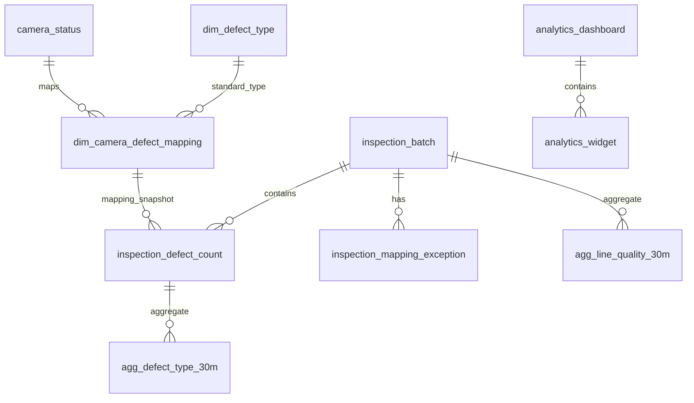
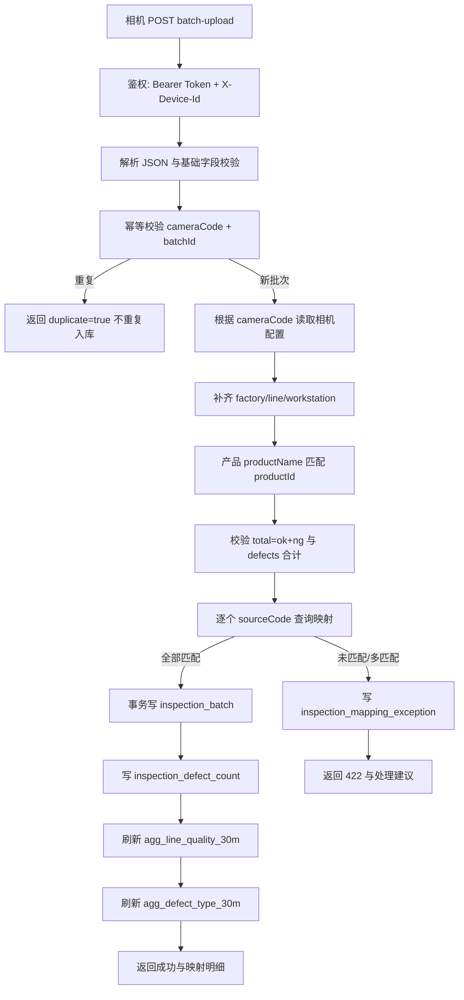
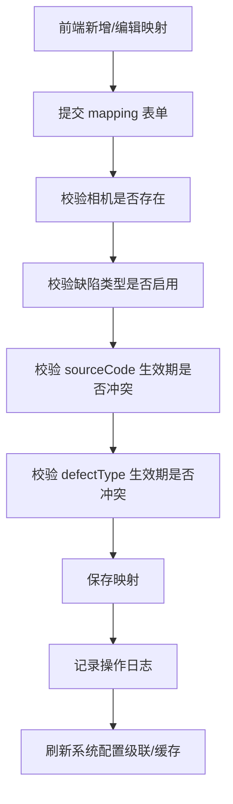
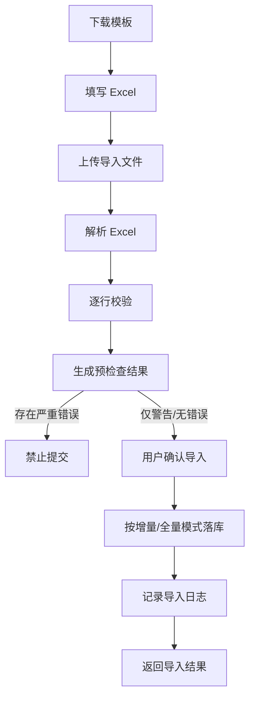
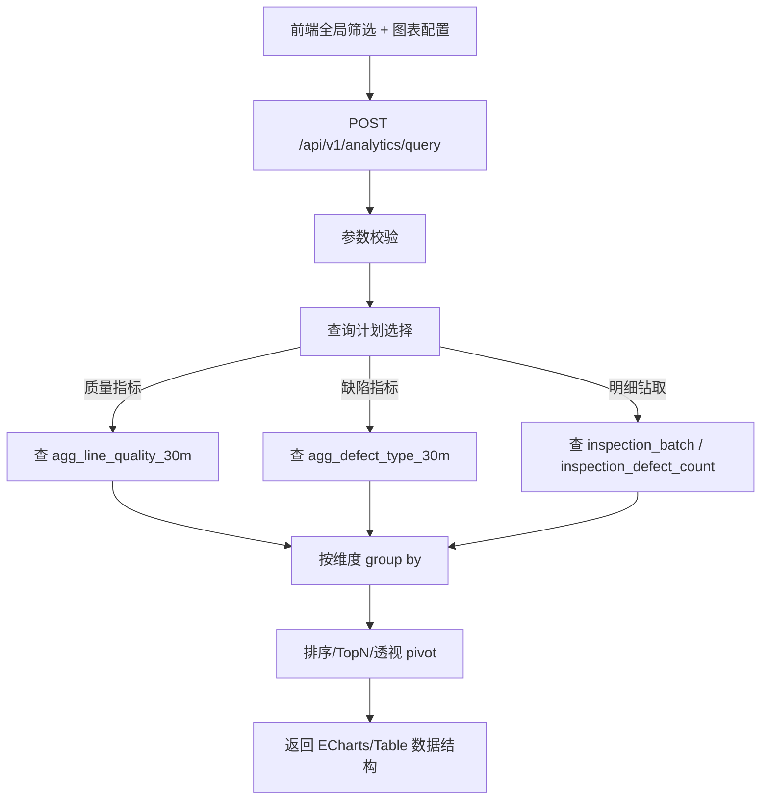

# 缺陷映射与动态报表后续功能开发设计文档

版本：v1.0  
日期：2026-06-08  
系统：产线缺陷在线AI检测系统  
状态：已评审确认，可进入 P0 开发实施  
关联原型：`prototype-defect-mapping-line-analytics-20260608.html`  
关联确认：`缺陷映射与动态报表默认推进确认-20260608.md`

---

## 1. 文档目标

本文用于评审后续功能开发方案，覆盖：

1. 新版相机批量检测数据上报。
2. 系统配置中的缺陷类型与相机缺陷映射。
3. 数据库存储模型、索引和聚合模型。
4. 数据处理流程：上报、映射、落库、聚合、查询、异常处理。
5. 产线统计动态报表工作台。
6. 前后端接口设计、开发拆解、验收标准。

本轮默认推进口径：

- 主 Tab：`相机状态 / 图像记录 / 产线统计`。
- P0：先完成相机缺陷映射 + 新版上报协议闭环。
- P1：完成产线统计动态报表。
- 计数模式：P0 仅支持 `INCREMENTAL` 增量计数。
- 映射粒度：相机级 1 对 1。
- 未配置编码：返回 `422` 并记录映射异常。

---

## 2. 功能范围

## 2.1 P0 范围：缺陷映射与上报闭环

### 后端

1. 重构 `/api/v1/camera/inspection/batch-upload`。
2. 新增相机缺陷映射模型。
3. 新增检测批次表、检测缺陷计数表、映射异常表。
4. 新增 30 分钟聚合表。
5. 新增映射配置 CRUD、导入预检查、导入提交接口。
6. 上报时根据相机和 sourceCode 做精确映射。
7. 未映射、重复映射、生效期冲突返回明确错误。

### 前端

1. 系统配置页面新增“相机缺陷映射”菜单。
2. 映射表支持搜索、级联筛选、分页、编辑、停用。
3. 映射新增/编辑弹窗。
4. 导入预检查弹窗。
5. 停用二次确认和风险提示。
6. 相机状态和图像记录保留现有交互，不重复展示图像表格。

## 2.2 P1 范围：产线统计动态报表

### 后端

1. 新增动态报表查询接口。
2. 新增看板、图表组件配置表。
3. 图表查询默认读取聚合表。
4. 支持动态维度、指标、TopN、排序、透视表。
5. 查询保护：限制时间跨度、维度数量、TopN。

### 前端

1. 主 Tab 新增“产线统计”。
2. 顶部维持现有工厂/产线/工位级联筛选。
3. 页面内增加时间、产品、班次、相机、缺陷类型、缺陷位置、严重度筛选。
4. 支持图表组件库、画布、图表配置面板。
5. 支持新增、编辑、删除、拖拽、调整大小、保存布局。
6. 支持映射异常卡片跳转配置。

---

## 3. 当前实现影响分析

## 3.1 现有相关对象

| 类型 | 当前对象 | 说明 |
|---|---|---|
| 后端 Controller | `BatchUploadController` | 当前 `/api/v1/camera/inspection/batch-upload` 仍基于旧 `BatchUploadDTO` |
| 后端 DTO | `BatchUploadDTO` | 包含旧 `dataList` 和写死缺陷字段 |
| 后端 Service | `ProductDetectionHistoryServiceImpl` | 当前主要写入 `product_detection_history` |
| 前端配置页 | `ConfigView.vue` | 已有工厂、产线、工位、相机、用户、操作记录等配置能力 |
| 前端缺陷类型 | `DefectTypeList.vue` | 已有缺陷类型管理基础 |
| 前端主布局 | `Layout.vue` | 当前主 Tab 为相机状态、图像记录 |
| 前端图像记录 | `CameraImageRecords.vue` | 已支持按相机展开图像记录和图片预览 |
| 数据库 | `dim_defect_type` | 当前标准缺陷类型基础表 |
| 数据库 | `camera_status` | 当前相机状态与心跳信息表 |
| 数据库 | `defect_image_*` | 当前缺陷图片批次、文件、缺陷框表 |

## 3.2 需要废弃或降级的旧设计

| 旧设计 | 问题 | 处理方式 |
|---|---|---|
| `BatchUploadDTO.dataList[]` | 结构偏明细，且包含大量写死字段 | 新版 DTO 替换，旧 DTO 不作为正式协议 |
| `innerGlue13` 等固定字段 | 缺陷类型变化必须改代码/改表 | 统一改为 `defects[].sourceCode + count` |
| 上报中直接传业务缺陷名 | 相机协议不稳定，现场调整困难 | 后台配置映射，设备只上报 sourceCode |
| 统计直接扫明细表 | 数据量大后查询慢 | 默认查 30 分钟聚合表 |

---

## 4. 数据库模型设计

## 4.1 设计原则

1. **配置归配置**：缺陷类型、相机映射、工厂/产线/工位/相机归属由系统配置维护。
2. **上报归上报**：相机只上报稳定编码和数量，不参与配置关系修改。
3. **明细可追溯**：每次上报批次和映射快照可追溯。
4. **查询走聚合**：看板统计默认读取聚合表。
5. **动态缺陷不做宽表**：缺陷类型新增后不新增数据库字段，由查询层 group/pivot。

## 4.2 表关系概览



---

## 4.3 标准缺陷类型表：`dim_defect_type`

现有表保留，建议补充字段或在后续版本迁移。

### 建议字段

| 字段 | 类型 | 说明 |
|---|---|---|
| `defect_id` | INT PK | 缺陷类型 ID |
| `defect_code` | VARCHAR(50) | 标准缺陷编码，唯一 |
| `defect_name` | VARCHAR(100) | 标准缺陷名称 |
| `defect_category` | VARCHAR(50) | 缺陷类别，如 GLUE/DIRT/JOINT |
| `default_position_code` | VARCHAR(50) | 默认缺陷位置 |
| `default_severity` | VARCHAR(20) | 默认严重度 HIGH/MEDIUM/LOW |
| `is_ng` | TINYINT | 是否计入 NG，默认 1 |
| `is_active` | TINYINT | 是否启用 |
| `is_deleted` | TINYINT | 是否删除 |
| `sort_order` | INT | 排序 |

### 兼容建议

当前已有 `defect_area / defect_type / defect_size / severity_level`，P0 可先复用，P1 再补充 `default_position_code / default_severity / is_ng`。

---

## 4.4 相机缺陷映射表：`dim_camera_defect_mapping`

### 用途

维护相机上报编码与系统标准缺陷类型的精确映射。

### DDL 建议

```sql
CREATE TABLE dim_camera_defect_mapping (
  mapping_id BIGINT PRIMARY KEY AUTO_INCREMENT COMMENT '映射ID',
  factory_id INT NULL COMMENT '工厂ID',
  line_id INT NULL COMMENT '产线ID',
  workstation_id INT NULL COMMENT '工位ID',
  camera_id BIGINT NULL COMMENT 'camera_status.id',
  camera_code VARCHAR(50) NOT NULL COMMENT '相机编号',
  product_id INT NULL COMMENT '产品ID；为空表示该相机通用映射',
  product_name VARCHAR(100) NULL COMMENT '产品名称快照；便于排查和导入校验',
  source_code VARCHAR(50) NOT NULL COMMENT '相机上报编码，如 p0/p1',
  defect_type_id INT NOT NULL COMMENT '标准缺陷类型ID',
  defect_code VARCHAR(50) NOT NULL COMMENT '标准缺陷编码快照',
  defect_name VARCHAR(100) NOT NULL COMMENT '标准缺陷名称快照',
  default_position_code VARCHAR(50) NULL COMMENT '默认缺陷位置编码',
  default_position_name VARCHAR(100) NULL COMMENT '默认缺陷位置名称',
  default_severity VARCHAR(20) NULL COMMENT '默认严重度 HIGH/MEDIUM/LOW',
  is_ng TINYINT NOT NULL DEFAULT 1 COMMENT '是否计入NG',
  is_enabled TINYINT NOT NULL DEFAULT 1 COMMENT '是否启用',
  effective_start DATETIME NOT NULL COMMENT '生效开始时间',
  effective_end DATETIME NULL COMMENT '生效结束时间，空表示长期有效',
  create_by BIGINT NULL,
  update_by BIGINT NULL,
  create_time DATETIME NOT NULL DEFAULT CURRENT_TIMESTAMP,
  update_time DATETIME NOT NULL DEFAULT CURRENT_TIMESTAMP ON UPDATE CURRENT_TIMESTAMP,
  UNIQUE KEY uk_camera_product_source_start (camera_code, product_id, source_code, effective_start),
  KEY idx_camera_product_source_time (camera_code, product_id, source_code, effective_start, effective_end),
  KEY idx_scope (factory_id, line_id, workstation_id, camera_code, product_id),
  KEY idx_defect_type (defect_type_id),
  KEY idx_enabled (is_enabled)
) ENGINE=InnoDB DEFAULT CHARSET=utf8mb4 COMMENT='相机上报编码与标准缺陷类型映射表';
```

### 后端强校验

MySQL 普通唯一索引无法完全校验“时间区间不重叠”，因此保存时后端必须校验：

1. 同一 `camera_code + product_id + source_code`，启用映射的生效区间不能重叠。
2. 同一 `camera_code + product_id + defect_type_id`，启用映射的生效区间不能重叠。
3. `effective_end` 不为空时必须大于 `effective_start`。
4. `camera_code` 必须存在于 `camera_status` 或相机配置表。
5. `defect_type_id` 必须存在且启用。
6. `product_id` 为空表示相机通用映射；当同时存在产品专属映射和通用映射时，优先使用产品专属映射。

### 4.4.1 产品维度缺陷项扩展设计

当某种产品拆分出 15 种缺陷项时，不新增 15 个数据库固定字段，也不新增 `p0_count / p1_count / ... / p14_count` 这类宽表列。统一按“配置行 + 明细行 + 动态列展示”处理。

#### 设计原则

1. 相机上报协议保持稳定，缺陷仍然放在 `defects[]` 数组中。
2. 15 种缺陷项在系统配置中维护为 15 条标准缺陷类型或产品专属缺陷类型。
3. 相机上报编码 `p0 ~ p14` 通过映射表绑定到标准缺陷类型。
4. 如果同一台相机检测不同产品，映射粒度升级为：

```text
产品 + 相机 + sourceCode => 标准缺陷类型
```

5. 如果某产品未配置专属映射，则可回退到 `product_id IS NULL` 的相机通用映射。
6. 页面动态生成缺陷列；缺陷类型新增或减少时，不需要修改数据库表结构和前端固定字段。

#### 上报数据示例

产品 A 有 15 种缺陷项时，相机最多上报 15 条缺陷计数。数量为 0 的缺陷项可以不上报，页面按 0 处理。

```json
{
  "productName": "产品A",
  "cameraCode": "CAM-001",
  "counterMode": "INCREMENTAL",
  "summary": {
    "totalCount": 1200,
    "okCount": 1160,
    "ngCount": 40
  },
  "defects": [
    { "sourceCode": "p0", "count": 12 },
    { "sourceCode": "p1", "count": 8 },
    { "sourceCode": "p2", "count": 0 },
    { "sourceCode": "p3", "count": 5 }
  ]
}
```

#### 后台保存方式

后台按行保存，不按列保存：

| 产品 | 相机 | 上报编码 | 标准缺陷类型 | 数量 |
|---|---|---|---|---:|
| 产品A | CAM-001 | p0 | 前腰污点 | 12 |
| 产品A | CAM-001 | p1 | 内装胶滴 | 8 |
| 产品A | CAM-001 | p3 | 复合接头 | 5 |

#### 页面展示方式

动态透视表按产品配置生成缺陷列：

| 工位 | 检测总数 | OK数 | NG数 | 前腰污点 | 内装胶滴 | 后腰污点 | 复合接头 | ... |
|---|---:|---:|---:|---:|---:|---:|---:|---:|
| 涂布工位 | 120000 | 118900 | 1100 | 320 | 180 | 90 | 40 | ... |
| 复合工位 | 98000 | 96950 | 1050 | 210 | 300 | 60 | 120 | ... |

展示规则：

- 表格支持横向滚动。
- 默认展示 Top 10 缺陷列。
- 超过 Top 10 的缺陷项折叠到“更多缺陷”或由用户勾选显示。
- 图表默认展示 TopN 缺陷，剩余缺陷可合并为“其他”。
- 趋势图不默认展示全部 15 条线，需由用户选择要关注的缺陷类型。

---

## 4.5 检测批次表：`inspection_batch`

### 用途

保存每一次相机批量检测上报主记录。

### DDL 建议

```sql
CREATE TABLE inspection_batch (
  id BIGINT PRIMARY KEY AUTO_INCREMENT,
  batch_id VARCHAR(100) NOT NULL COMMENT '设备侧批次号',
  request_id VARCHAR(100) NULL COMMENT '请求ID',
  schema_version VARCHAR(20) NOT NULL DEFAULT '2.0',
  device_id VARCHAR(100) NOT NULL,
  camera_id BIGINT NULL,
  camera_code VARCHAR(50) NOT NULL,
  camera_name VARCHAR(100) NULL,
  factory_id INT NULL,
  line_id INT NULL,
  workstation_id INT NULL,
  product_id INT NULL,
  product_name VARCHAR(100) NULL COMMENT '原始产品名称',
  shift_id INT NULL,
  report_time DATETIME NOT NULL,
  start_time DATETIME NOT NULL,
  end_time DATETIME NOT NULL,
  counter_mode VARCHAR(20) NOT NULL DEFAULT 'INCREMENTAL',
  total_count INT NOT NULL DEFAULT 0,
  ok_count INT NOT NULL DEFAULT 0,
  ng_count INT NOT NULL DEFAULT 0,
  mapped_defect_count INT NOT NULL DEFAULT 0,
  unmapped_defect_count INT NOT NULL DEFAULT 0,
  status VARCHAR(20) NOT NULL DEFAULT 'ACCEPTED' COMMENT 'ACCEPTED/REJECTED/DUPLICATE/PARTIAL',
  error_message VARCHAR(500) NULL,
  raw_json JSON NULL,
  create_time DATETIME NOT NULL DEFAULT CURRENT_TIMESTAMP,
  UNIQUE KEY uk_camera_batch (camera_code, batch_id),
  KEY idx_report_scope (report_time, factory_id, line_id, workstation_id, camera_code),
  KEY idx_product_shift_time (product_id, product_name, shift_id, report_time),
  KEY idx_status_time (status, report_time)
) ENGINE=InnoDB DEFAULT CHARSET=utf8mb4 COMMENT='检测批次上报主表';
```

---

## 4.6 检测缺陷计数表：`inspection_defect_count`

### 用途

保存每个批次中，每个 sourceCode 映射后的标准缺陷计数。

### DDL 建议

```sql
CREATE TABLE inspection_defect_count (
  id BIGINT PRIMARY KEY AUTO_INCREMENT,
  batch_pk BIGINT NOT NULL COMMENT 'inspection_batch.id',
  batch_id VARCHAR(100) NOT NULL,
  camera_code VARCHAR(50) NOT NULL,
  factory_id INT NULL,
  line_id INT NULL,
  workstation_id INT NULL,
  product_id INT NULL,
  product_name VARCHAR(100) NULL,
  shift_id INT NULL,
  report_time DATETIME NOT NULL,
  time_bucket_10m DATETIME NOT NULL,
  time_bucket_30m DATETIME NOT NULL,
  source_code VARCHAR(50) NOT NULL,
  mapping_id BIGINT NOT NULL,
  defect_type_id INT NOT NULL,
  defect_code VARCHAR(50) NOT NULL,
  defect_name VARCHAR(100) NOT NULL,
  position_code VARCHAR(50) NULL,
  position_name VARCHAR(100) NULL,
  severity VARCHAR(20) NULL,
  defect_count INT NOT NULL DEFAULT 0,
  is_ng TINYINT NOT NULL DEFAULT 1,
  create_time DATETIME NOT NULL DEFAULT CURRENT_TIMESTAMP,
  KEY idx_batch (batch_pk),
  KEY idx_time_line_defect (time_bucket_30m, line_id, defect_type_id),
  KEY idx_time_station_defect (time_bucket_30m, workstation_id, defect_type_id),
  KEY idx_time_camera_defect (time_bucket_30m, camera_code, defect_type_id),
  KEY idx_filter_combo (factory_id, line_id, workstation_id, camera_code, product_id, shift_id, report_time),
  KEY idx_position_severity (position_code, severity, report_time)
) ENGINE=InnoDB DEFAULT CHARSET=utf8mb4 COMMENT='检测缺陷计数明细表';
```

---

## 4.7 映射异常表：`inspection_mapping_exception`

### 用途

记录上报时未匹配、重复匹配、停用映射等异常，供页面处理。

### DDL 建议

```sql
CREATE TABLE inspection_mapping_exception (
  id BIGINT PRIMARY KEY AUTO_INCREMENT,
  batch_id VARCHAR(100) NOT NULL,
  request_id VARCHAR(100) NULL,
  camera_code VARCHAR(50) NOT NULL,
  source_code VARCHAR(50) NOT NULL,
  exception_type VARCHAR(50) NOT NULL COMMENT 'UNMAPPED/DUPLICATED/DISABLED/EXPIRED/COUNT_MISMATCH',
  exception_message VARCHAR(500) NOT NULL,
  suggestion VARCHAR(500) NULL,
  factory_id INT NULL,
  line_id INT NULL,
  workstation_id INT NULL,
  report_time DATETIME NULL,
  status VARCHAR(20) NOT NULL DEFAULT 'OPEN' COMMENT 'OPEN/PROCESSING/CLOSED/IGNORED',
  handled_by BIGINT NULL,
  handled_time DATETIME NULL,
  create_time DATETIME NOT NULL DEFAULT CURRENT_TIMESTAMP,
  KEY idx_camera_source_status (camera_code, source_code, status),
  KEY idx_scope_time (factory_id, line_id, workstation_id, report_time),
  KEY idx_type_status (exception_type, status)
) ENGINE=InnoDB DEFAULT CHARSET=utf8mb4 COMMENT='检测上报映射异常表';
```

---

## 4.8 质量 30 分钟聚合表：`agg_line_quality_30m`

### 用途

产线统计中检测总数、OK、NG、良率等基础指标查询。

```sql
CREATE TABLE agg_line_quality_30m (
  id BIGINT PRIMARY KEY AUTO_INCREMENT,
  time_bucket DATETIME NOT NULL,
  factory_id INT NULL,
  line_id INT NULL,
  workstation_id INT NULL,
  camera_code VARCHAR(50) NULL,
  product_id INT NULL,
  product_name VARCHAR(100) NULL,
  shift_id INT NULL,
  total_count BIGINT NOT NULL DEFAULT 0,
  ok_count BIGINT NOT NULL DEFAULT 0,
  ng_count BIGINT NOT NULL DEFAULT 0,
  defect_count BIGINT NOT NULL DEFAULT 0,
  yield_rate DECIMAL(8,4) NULL,
  ng_rate DECIMAL(8,4) NULL,
  update_time DATETIME NOT NULL DEFAULT CURRENT_TIMESTAMP ON UPDATE CURRENT_TIMESTAMP,
  UNIQUE KEY uk_scope_bucket (time_bucket, factory_id, line_id, workstation_id, camera_code, product_id, shift_id),
  KEY idx_time_factory_line (time_bucket, factory_id, line_id),
  KEY idx_line_time (line_id, time_bucket),
  KEY idx_station_time (workstation_id, time_bucket),
  KEY idx_camera_time (camera_code, time_bucket)
) ENGINE=InnoDB DEFAULT CHARSET=utf8mb4 COMMENT='产线质量30分钟聚合表';
```

---

## 4.9 缺陷类型 30 分钟聚合表：`agg_defect_type_30m`

### 用途

缺陷类型排行、构成、动态透视表、热力图查询。

```sql
CREATE TABLE agg_defect_type_30m (
  id BIGINT PRIMARY KEY AUTO_INCREMENT,
  time_bucket DATETIME NOT NULL,
  factory_id INT NULL,
  line_id INT NULL,
  workstation_id INT NULL,
  camera_code VARCHAR(50) NULL,
  product_id INT NULL,
  product_name VARCHAR(100) NULL,
  shift_id INT NULL,
  defect_type_id INT NOT NULL,
  defect_code VARCHAR(50) NOT NULL,
  defect_name VARCHAR(100) NOT NULL,
  position_code VARCHAR(50) NULL,
  severity VARCHAR(20) NULL,
  defect_count BIGINT NOT NULL DEFAULT 0,
  update_time DATETIME NOT NULL DEFAULT CURRENT_TIMESTAMP ON UPDATE CURRENT_TIMESTAMP,
  KEY idx_time_defect (time_bucket, defect_type_id),
  KEY idx_line_defect_time (line_id, defect_type_id, time_bucket),
  KEY idx_station_defect_time (workstation_id, defect_type_id, time_bucket),
  KEY idx_camera_defect_time (camera_code, defect_type_id, time_bucket),
  KEY idx_position_time (position_code, time_bucket),
  KEY idx_severity_time (severity, time_bucket)
) ENGINE=InnoDB DEFAULT CHARSET=utf8mb4 COMMENT='缺陷类型30分钟聚合表';
```

---

## 4.10 动态报表看板表：`analytics_dashboard`

```sql
CREATE TABLE analytics_dashboard (
  dashboard_id BIGINT PRIMARY KEY AUTO_INCREMENT,
  dashboard_name VARCHAR(100) NOT NULL,
  factory_id INT NULL COMMENT 'P1按工厂保存默认看板',
  owner_user_id BIGINT NULL COMMENT 'P2个人看板使用',
  scope_type VARCHAR(20) NOT NULL DEFAULT 'FACTORY' COMMENT 'FACTORY/USER/GLOBAL',
  is_default TINYINT NOT NULL DEFAULT 0,
  layout_json JSON NULL COMMENT '画布布局快照',
  create_by BIGINT NULL,
  update_by BIGINT NULL,
  create_time DATETIME NOT NULL DEFAULT CURRENT_TIMESTAMP,
  update_time DATETIME NOT NULL DEFAULT CURRENT_TIMESTAMP ON UPDATE CURRENT_TIMESTAMP,
  KEY idx_scope (scope_type, factory_id, owner_user_id),
  KEY idx_default (is_default)
) ENGINE=InnoDB DEFAULT CHARSET=utf8mb4 COMMENT='动态统计看板';
```

---

## 4.11 动态报表组件表：`analytics_widget`

```sql
CREATE TABLE analytics_widget (
  widget_id BIGINT PRIMARY KEY AUTO_INCREMENT,
  dashboard_id BIGINT NOT NULL,
  widget_name VARCHAR(100) NOT NULL,
  widget_type VARCHAR(30) NOT NULL COMMENT 'KPI/LINE/BAR/STACK_BAR/PIE/RANK/HEATMAP/PIVOT/TABLE',
  metric_json JSON NOT NULL COMMENT '指标配置',
  dimension_json JSON NOT NULL COMMENT '维度配置',
  filter_json JSON NULL COMMENT '组件独立筛选',
  option_json JSON NULL COMMENT '图例、标签、TopN、排序等配置',
  layout_json JSON NOT NULL COMMENT 'x/y/w/h布局',
  follow_global_filter TINYINT NOT NULL DEFAULT 1,
  sort_order INT NOT NULL DEFAULT 0,
  create_time DATETIME NOT NULL DEFAULT CURRENT_TIMESTAMP,
  update_time DATETIME NOT NULL DEFAULT CURRENT_TIMESTAMP ON UPDATE CURRENT_TIMESTAMP,
  KEY idx_dashboard (dashboard_id),
  KEY idx_type (widget_type)
) ENGINE=InnoDB DEFAULT CHARSET=utf8mb4 COMMENT='动态统计图表组件';
```

---

## 5. 数据处理流程设计

## 5.1 新版检测上报处理流程



### 关键处理规则

| 阶段 | 规则 |
|---|---|
| 鉴权 | `Authorization` 必填，设备 Token 独立于用户 Token |
| 设备校验 | `X-Device-Id` 与 `cameraCode` 必须存在绑定关系 |
| 幂等 | `cameraCode + batchId` 唯一，重复上报不重复累计 |
| 计数 | P0 仅支持 `INCREMENTAL` |
| 映射 | `cameraCode + sourceCode + reportTime` 必须唯一匹配 |
| 异常 | 未映射、多映射、停用、过期均返回 `422` |
| 事务 | 批次、缺陷计数、聚合刷新需要事务或最终一致 |

---

## 5.2 映射配置保存流程



### 保存失败示例

| 场景 | 返回原因 |
|---|---|
| `CAM-001 + p0` 已存在有效映射 | 当前相机 p0 已映射到其他缺陷类型 |
| `CAM-001 + FRONT_DIRT_3_UP` 已被 p1 绑定 | 同一相机同一缺陷类型不能被多个 sourceCode 绑定 |
| 缺陷类型停用 | 不能绑定停用缺陷类型 |
| 相机不存在 | 请先在系统配置中维护相机 |
| 生效结束早于开始 | 生效时间不合法 |

---

## 5.3 映射导入流程



### 导入模式

| 模式 | 说明 |
|---|---|
| 增量导入 | 按相机编号 + sourceCode 新增或更新，不处理文件外映射 |
| 全量导入 | 以文件为准，文件外映射可标记停用；必须二次确认 |

### 预检查结果字段

| 字段 | 说明 |
|---|---|
| totalRows | 总行数 |
| successRows | 可导入行数 |
| createRows | 新增行数 |
| updateRows | 更新行数 |
| warningRows | 警告行数 |
| errorRows | 错误行数 |
| errors[] | 行号、字段、原因、建议 |

---

## 5.4 聚合处理流程

P0 可采用同步聚合，P1/P2 建议改成异步。

### P0 同步聚合

```text
上报事务内写入 inspection_batch / inspection_defect_count
  ↓
按 time_bucket_30m + scope upsert agg_line_quality_30m
  ↓
按 time_bucket_30m + defect_type upsert agg_defect_type_30m
```

优点：实现简单，上报后图表立即可见。  
风险：高并发上报时接口响应变慢。

### P1 异步聚合

```text
上报落明细
  ↓
写 aggregation_task 或消息队列
  ↓
后台任务按批次刷新聚合
  ↓
图表查询聚合表
```

优点：上报接口稳定。  
风险：图表数据可能延迟几十秒。

默认建议：P0 同步，P1 引入异步任务。

---

## 5.5 动态报表查询流程



### 查询保护

| 限制项 | P1 默认值 |
|---|---:|
| 默认时间范围 | 今天 |
| 最大明细查询时间跨度 | 7 天 |
| 最大聚合查询时间跨度 | 90 天 |
| 最大维度数 | 3 个 |
| TopN 最大值 | 50 |
| 表格分页默认 | 10 条 |
| 表格分页可选 | 10 / 20 / 50 / 100 |

---

## 6. 新版上报接口设计

## 6.1 请求

```http
POST /api/v1/camera/inspection/batch-upload
Content-Type: application/json
Authorization: Bearer <device-token>
X-Device-Id: DEV-001
X-Request-Id: REQ-20260608-0001
```

```json
{
  "schemaVersion": "2.0",
  "batchId": "CAM-001-20260608-103000-0001",
  "deviceId": "DEV-001",
  "cameraCode": "CAM-001",
  "cameraName": "1号检测相机",
  "productName": "纸尿裤L码",
  "reportTime": "2026-06-08 10:30:00",
  "timeRange": {
    "startTime": "2026-06-08 10:29:00",
    "endTime": "2026-06-08 10:30:00"
  },
  "counterMode": "INCREMENTAL",
  "summary": {
    "totalCount": 1200,
    "okCount": 1160,
    "ngCount": 40
  },
  "defects": [
    {
      "sourceCode": "p0",
      "count": 12,
      "positionCode": "FRONT_WAIST",
      "severity": "HIGH"
    },
    {
      "sourceCode": "p1",
      "count": 28,
      "positionCode": "INNER_LAYER",
      "severity": "MEDIUM"
    }
  ]
}
```

## 6.2 成功响应

```json
{
  "code": 200,
  "message": "上报成功",
  "data": {
    "batchId": "CAM-001-20260608-103000-0001",
    "duplicate": false,
    "cameraCode": "CAM-001",
    "totalCount": 1200,
    "okCount": 1160,
    "ngCount": 40,
    "mappedDefectCount": 40,
    "mappingDetails": [
      {
        "sourceCode": "p0",
        "defectCode": "FRONT_DIRT_3_UP",
        "defectName": "前腰腹异物污点（3mm²以上）",
        "count": 12
      }
    ]
  }
}
```

## 6.3 映射失败响应

```json
{
  "code": 422,
  "message": "缺陷编码映射失败",
  "data": {
    "batchId": "CAM-001-20260608-103000-0002",
    "cameraCode": "CAM-001",
    "errors": [
      {
        "sourceCode": "p9",
        "reason": "当前相机未配置 sourceCode=p9 的缺陷映射",
        "suggestion": "请在系统配置 > 相机缺陷映射中为 CAM-001 配置 p9 对应的标准缺陷类型"
      }
    ]
  }
}
```

---

## 7. 后端接口清单

## 7.1 相机上报

| 方法 | 路径 | 说明 |
|---|---|---|
| POST | `/api/v1/camera/inspection/batch-upload` | 新版检测批量上报 |

## 7.2 相机缺陷映射配置

| 方法 | 路径 | 说明 |
|---|---|---|
| GET | `/api/v1/config/camera-defect-mappings` | 分页查询映射 |
| GET | `/api/v1/config/camera-defect-mappings/{id}` | 查询详情 |
| POST | `/api/v1/config/camera-defect-mappings` | 新增映射 |
| PUT | `/api/v1/config/camera-defect-mappings/{id}` | 修改映射 |
| DELETE | `/api/v1/config/camera-defect-mappings/{id}` | 停用映射 |
| POST | `/api/v1/config/camera-defect-mappings/import/preview` | 导入预检查 |
| POST | `/api/v1/config/camera-defect-mappings/import/commit` | 确认导入 |

## 7.3 映射异常

| 方法 | 路径 | 说明 |
|---|---|---|
| GET | `/api/v1/inspection/mapping-exceptions` | 查询映射异常 |
| PUT | `/api/v1/inspection/mapping-exceptions/{id}/close` | 关闭异常 |
| PUT | `/api/v1/inspection/mapping-exceptions/{id}/ignore` | 忽略异常 |

## 7.4 动态报表

| 方法 | 路径 | 说明 |
|---|---|---|
| GET | `/api/v1/analytics/metadata` | 获取支持的指标、维度、图表类型 |
| POST | `/api/v1/analytics/query` | 图表查询 |
| GET | `/api/v1/analytics/dashboards` | 看板列表 |
| POST | `/api/v1/analytics/dashboards` | 新建看板 |
| PUT | `/api/v1/analytics/dashboards/{id}` | 保存看板布局 |
| DELETE | `/api/v1/analytics/dashboards/{id}` | 删除看板 |
| POST | `/api/v1/analytics/widgets` | 新建图表组件 |
| PUT | `/api/v1/analytics/widgets/{id}` | 修改图表组件 |
| DELETE | `/api/v1/analytics/widgets/{id}` | 删除图表组件 |

---

## 8. 后端开发设计

## 8.1 建议包结构

```text
com.wms.controller.inspection
  InspectionUploadController
  InspectionMappingExceptionController

com.wms.controller.config
  CameraDefectMappingController

com.wms.controller.analytics
  AnalyticsDashboardController
  AnalyticsQueryController

com.wms.dto.inspection
  InspectionBatchUploadRequest
  InspectionBatchUploadResponse
  InspectionSummaryDTO
  InspectionDefectItemDTO
  InspectionMappingDetailDTO

com.wms.service.inspection
  InspectionUploadService
  CameraConfigResolver
  DefectMappingResolver
  InspectionAggregationService

com.wms.service.config
  CameraDefectMappingService
  CameraDefectMappingImportService

com.wms.service.analytics
  AnalyticsQueryService
  AnalyticsDashboardService
```

## 8.2 核心服务职责

| 服务 | 职责 |
|---|---|
| `InspectionUploadService` | 上报入口编排、事务控制 |
| `CameraConfigResolver` | 根据相机编号补齐工厂/产线/工位 |
| `DefectMappingResolver` | sourceCode 到标准缺陷类型映射 |
| `InspectionAggregationService` | 聚合表刷新 |
| `CameraDefectMappingService` | 映射配置 CRUD 与冲突校验 |
| `CameraDefectMappingImportService` | 模板解析、预检查、提交导入 |
| `AnalyticsQueryService` | 动态报表查询、透视、TopN |
| `AnalyticsDashboardService` | 看板和组件配置保存 |

## 8.3 事务边界

P0 建议一个上报批次使用一个事务：

```text
insert inspection_batch
insert inspection_defect_count
upsert agg_line_quality_30m
upsert agg_defect_type_30m
```

如果映射失败：

```text
insert inspection_mapping_exception
return 422
```

是否保存 `inspection_batch` 为 `REJECTED` 可配置。默认建议保存，便于审计。

---

## 9. 前端开发设计

## 9.1 路由设计

| 路由 | 页面 | 阶段 |
|---|---|---|
| `/camera-status` | 相机状态 | 已有，保留 |
| `/stats/images` | 图像记录 | 已有，保留 |
| `/line-analytics` | 产线统计动态报表 | P1 新增 |
| `/system/config` | 系统配置聚合页 | 已有，P0 增加映射菜单 |

## 9.2 系统配置新增模块

在 `ConfigView.vue` 中新增菜单：

```text
相机缺陷映射
```

建议拆组件：

```text
src/views/system/ConfigView.vue
src/components/config/CameraDefectMappingPanel.vue
src/components/config/CameraDefectMappingDialog.vue
src/components/config/CameraDefectMappingImportDialog.vue
src/api/camera-defect-mapping.js
```

## 9.3 产线统计新增模块

建议新增：

```text
src/views/stats/LineAnalyticsView.vue
src/components/analytics/AnalyticsFilterBar.vue
src/components/analytics/WidgetLibrary.vue
src/components/analytics/DashboardCanvas.vue
src/components/analytics/WidgetConfigPanel.vue
src/components/analytics/widgets/KpiWidget.vue
src/components/analytics/widgets/LineWidget.vue
src/components/analytics/widgets/BarWidget.vue
src/components/analytics/widgets/PivotTableWidget.vue
src/api/analytics.js
```

## 9.4 前端状态与交互

| 交互 | 设计 |
|---|---|
| 图表新增 | 弹窗/抽屉选择图表类型、指标、维度 |
| 图表编辑 | 右侧配置面板实时修改 |
| 拖拽布局 | 采用 grid-layout 类组件或自研 CSS Grid + 坐标保存 |
| 图表大小调整 | 保存 `x/y/w/h` 到 `analytics_widget.layout_json` |
| 图表筛选 | 默认跟随全局筛选，允许组件独立筛选 |
| 动态缺陷列 | 查询缺陷类型配置后生成列 |
| 映射异常 | 图表顶部卡片展示，点击跳转配置 |
| 空状态 | “当前筛选条件下暂无数据”，提供调整筛选建议 |
| 异常状态 | 展示接口错误、错误原因、重试按钮 |

---

## 10. 动态报表指标与维度设计

## 10.1 指标

| 指标编码 | 中文 | 计算方式 |
|---|---|---|
| `totalCount` | 检测总数 | `sum(total_count)` |
| `okCount` | OK 数 | `sum(ok_count)` |
| `ngCount` | NG 数 | `sum(ng_count)` |
| `defectCount` | 缺陷数 | `sum(defect_count)` |
| `yieldRate` | 良率 | `sum(ok_count) / sum(total_count)` |
| `ngRate` | NG率 | `sum(ng_count) / sum(total_count)` |
| `highDefectCount` | 高危缺陷数 | `severity='HIGH'` 的缺陷数 |
| `mappingExceptionCount` | 映射异常数 | `inspection_mapping_exception` OPEN 数 |

## 10.2 维度

| 维度编码 | 中文 | 数据来源 |
|---|---|---|
| `time` | 时间 | `time_bucket/report_time` |
| `factory` | 工厂 | `factory_id` |
| `line` | 产线 | `line_id` |
| `workstation` | 工位 | `workstation_id` |
| `camera` | 相机 | `camera_code` |
| `product` | 产品 | `product_id/product_name` |
| `shift` | 班次 | `shift_id` |
| `defectType` | 缺陷类型 | `defect_type_id` |
| `position` | 缺陷位置 | `position_code` |
| `severity` | 严重度 | `severity` |

## 10.3 图表类型

| 类型 | 编码 | 用途 |
|---|---|---|
| KPI 卡 | `KPI` | 汇总指标 |
| 折线图 | `LINE` | 时间趋势 |
| 柱状图 | `BAR` | 维度对比 |
| 堆叠柱图 | `STACK_BAR` | 构成对比 |
| 环形图 | `PIE` | 占比 |
| 排行榜 | `RANK` | TopN |
| 热力图 | `HEATMAP` | 时间 × 维度交叉 |
| 透视表 | `PIVOT` | 动态缺陷列 |
| 明细表 | `TABLE` | 批次/缺陷明细 |

## 10.4 产品 15 种缺陷项的页面呈现

当某产品配置了 15 种缺陷项时，产线统计页面按动态维度展示，而不是固定写死 15 个字段。

### 10.4.1 动态表格

动态透视表推荐配置：

| 配置项 | 默认值 |
|---|---|
| 行维度 | 工位 / 相机 |
| 列维度 | 产品当前启用的缺陷类型 |
| 指标 | 缺陷数量、NG 数、缺陷率 |
| 默认列 | Top 10 缺陷类型 |
| 其他列 | 折叠到“更多缺陷”，支持勾选显示 |
| 滚动 | 表格横向滚动 |

示例：

| 工位 | 检测总数 | OK数 | NG数 | 缺陷1 | 缺陷2 | 缺陷3 | ... | 缺陷15 |
|---|---:|---:|---:|---:|---:|---:|---:|---:|
| 涂布工位 | 120000 | 118900 | 1100 | 320 | 180 | 90 | ... | 12 |
| 复合工位 | 98000 | 96950 | 1050 | 210 | 300 | 60 | ... | 8 |

### 10.4.2 动态图表

| 图表 | 默认策略 |
|---|---|
| 缺陷 TopN 排行 | 默认展示 Top 10，剩余合并“其他” |
| 堆叠柱图 | 产线/工位为 X 轴，缺陷类型为堆叠项 |
| 趋势图 | 不默认展示 15 条线，由用户勾选 1~5 个重点缺陷 |
| 热力图 | 行=工位/相机，列=缺陷类型，颜色=缺陷数量 |
| 环形图 | 缺陷类型占比，超过 10 项时合并低频项 |

### 10.4.3 配置联动

1. 产品筛选变化后，缺陷类型下拉和动态表格列同步变化。
2. 缺陷类型停用后，默认不展示该列；历史查询可选择“显示停用缺陷”。
3. 如果上报中出现该产品未配置的 `sourceCode`，进入映射异常，不参与正常缺陷列统计。
4. 如果产品未配置专属映射，则使用相机通用映射；如果两者都没有，返回 `422`。

---

## 11. 权限与审计

## 11.1 权限

| 功能 | 管理员 | 普通用户 |
|---|---:|---:|
| 查看相机缺陷映射 | 是 | 是 |
| 新增/编辑/停用映射 | 是 | 否 |
| 导入映射 | 是 | 否 |
| 查看产线统计 | 是 | 是 |
| 新增/编辑/删除图表 | 是 | 否 |
| 保存全局/工厂看板 | 是 | 否 |
| 临时筛选报表 | 是 | 是 |

## 11.2 审计

需要记录操作日志：

- 新增映射。
- 修改映射。
- 停用映射。
- 导入映射。
- 新增/修改/删除看板。
- 新增/修改/删除图表组件。

---

## 12. 测试方案

## 12.1 P0 测试数据

以杭州工厂为主：

- 工厂：杭州工厂。
- 产线：1号线、2号线。
- 工位：涂布区、复合区、检测区、包装区。
- 相机：CAM-001 ~ CAM-008。
- 缺陷类型：前腰污点、内装胶滴、复合接头等。
- 产品缺陷项扩展：为“产品A”配置 15 种缺陷项，模拟 `p0 ~ p14` 上报映射和动态表格列展示。
- 映射：
  - CAM-001 p0 → 前腰腹异物污点（HIGH）
  - CAM-001 p1 → 内装胶滴（MEDIUM）
  - CAM-002 p0 → 复合区域接头（HIGH）
  - CAM-003 p9 → 未配置，用于异常测试
  - 产品A + CAM-001 + p0 ~ p14 → 产品A 的 15 种缺陷类型，用于验证产品维度专属映射

## 12.2 核心用例

| 编号 | 用例 | 预期 |
|---|---|---|
| TC-P0-001 | 正常上报 p0/p1 | 返回 200，写批次、缺陷计数、聚合表 |
| TC-P0-002 | 重复 batchId | 返回 duplicate，不重复累计 |
| TC-P0-003 | 未配置 p9 | 返回 422，写映射异常 |
| TC-P0-004 | total != ok + ng | 返回 422 或校验失败 |
| TC-P0-005 | ng != defects sum | 返回 422 或校验失败 |
| TC-P0-006 | 保存重复映射 | 保存失败，提示冲突 |
| TC-P0-007 | 停用映射后上报 | 返回 422，进入异常 |
| TC-P0-008 | 导入映射预检查 | 展示新增/更新/错误行 |
| TC-P1-001 | 新增 KPI 图表 | 图表加入画布 |
| TC-P1-002 | 图表跟随筛选 | 数据刷新 |
| TC-P1-003 | 动态透视表列 | 列来自缺陷类型配置 |
| TC-P1-004 | 映射异常跳转 | 跳转系统配置映射页 |
| TC-P1-005 | 查询保护 | 超大时间范围提示缩小范围 |
| TC-P1-006 | 产品A配置15种缺陷项 | 动态表格生成15个缺陷列，默认展示Top10，其余可勾选 |
| TC-P1-007 | 产品A上报p0~p14 | 后台按15行缺陷计数保存，不新增固定字段 |
| TC-P1-008 | 产品切换 | 缺陷类型筛选项和透视表列随产品变化 |

---

## 13. 开发计划

## 13.1 P0 开发任务

| 序号 | 任务 | 负责人角色 | 产出 |
|---:|---|---|---|
| 1 | 新增数据库迁移脚本 | 后端 | SQL 脚本 |
| 2 | 新增上报 DTO | 后端 | DTO 类 |
| 3 | 重构 batch-upload | 后端 | Controller/Service |
| 4 | 实现映射 resolver | 后端 | DefectMappingResolver |
| 5 | 实现批次/缺陷落库 | 后端 | Mapper/Service |
| 6 | 实现聚合 upsert | 后端 | AggregationService |
| 7 | 实现映射配置接口 | 后端 | CRUD API |
| 8 | 实现导入预检查 | 后端 | import preview/commit |
| 9 | 系统配置新增映射页 | 前端 | Vue 组件 |
| 10 | 异常列表与跳转 | 前后端 | 异常处理入口 |
| 11 | 联调和测试数据 | 全栈 | 测试报告 |

## 13.2 P1 开发任务

| 序号 | 任务 | 负责人角色 | 产出 |
|---:|---|---|---|
| 1 | 新增产线统计路由和 Tab | 前端 | `LineAnalyticsView.vue` |
| 2 | 新增图表元数据接口 | 后端 | metadata API |
| 3 | 新增图表查询接口 | 后端 | analytics query API |
| 4 | 新增看板/组件配置表 | 后端 | SQL + Service |
| 5 | 图表组件库 | 前端 | WidgetLibrary |
| 6 | 图表画布和布局保存 | 前端 | DashboardCanvas |
| 7 | 图表配置面板 | 前端 | WidgetConfigPanel |
| 8 | KPI/折线/柱状/排行/透视表 | 前端 | 图表组件 |
| 9 | 查询保护和空状态 | 前后端 | 统一状态处理 |
| 10 | 回归验收 | QA/产品 | 验收报告 |

---

## 14. 风险与待评审点

| 风险 | 影响 | 建议 |
|---|---|---|
| 现场 sourceCode 频繁变化 | 映射异常增加 | 上线前冻结相机编码字典 |
| 历史映射变更影响统计口径 | 历史报表不一致 | 入库保存映射快照 |
| 聚合同步影响上报性能 | 接口响应变慢 | P0 同步，P1 异步任务化 |
| 动态报表配置过度自由 | 慢查询 | 限制维度数、时间跨度、TopN |
| 旧接口调用方未迁移 | 上报失败 | 提供迁移说明，P0 不再推荐旧 DTO |

---

## 15. 评审结论

评审时间：2026-06-08  
评审状态：已确认通过，可进入 P0 详细开发与数据库迁移脚本编写。

### 15.1 已确认事项

| 评审项 | 结论 |
|---|---|
| P0 是否只支持增量计数 | 是，P0 只支持 `INCREMENTAL` |
| 未映射编码是否坚持返回 `422` | 是，未映射、多映射、停用/过期映射均返回 `422` 并记录异常 |
| 聚合是否 P0 同步、P1 异步 | 是，P0 同步聚合，P1 改为异步聚合任务 |
| 表结构是否满足后续统计和追溯 | 是，按本文表结构推进 |
| 产线统计首期图表范围是否按文档执行 | 是，按 KPI、折线、柱状、堆叠柱、排行、透视表等首期范围执行 |

### 15.2 开发启动结论

后续无需再等待产品口径确认，按本文进入开发实施：

1. 先实施 P0：数据库迁移脚本、新版上报 DTO、上报接口重构、相机缺陷映射配置、映射异常处理。
2. P0 验收通过后实施 P1：产线统计动态报表、图表配置、看板布局保存、聚合异步化。
3. 所有测试数据以杭州工厂为主，覆盖产品A 15 种缺陷项、`p0 ~ p14` 映射、未映射 `p9` 异常场景。
