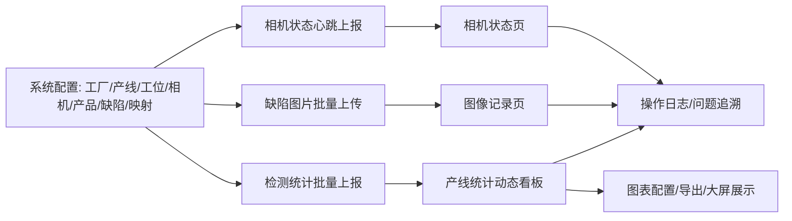
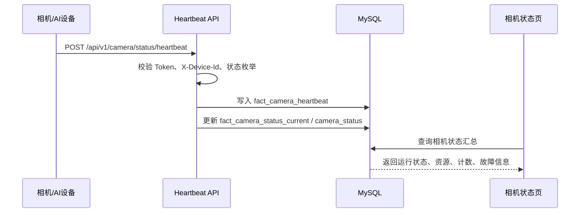
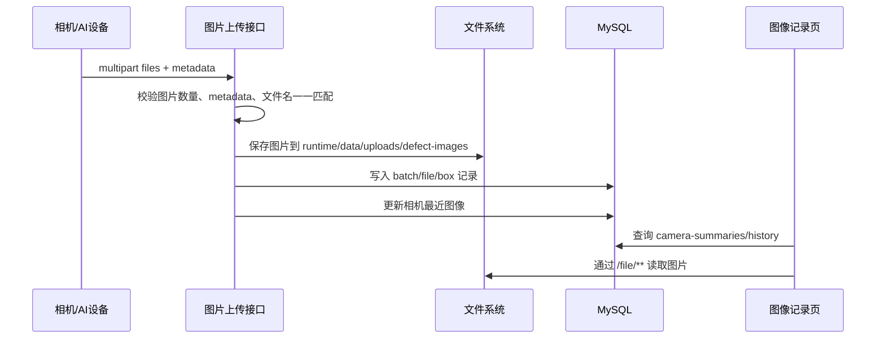
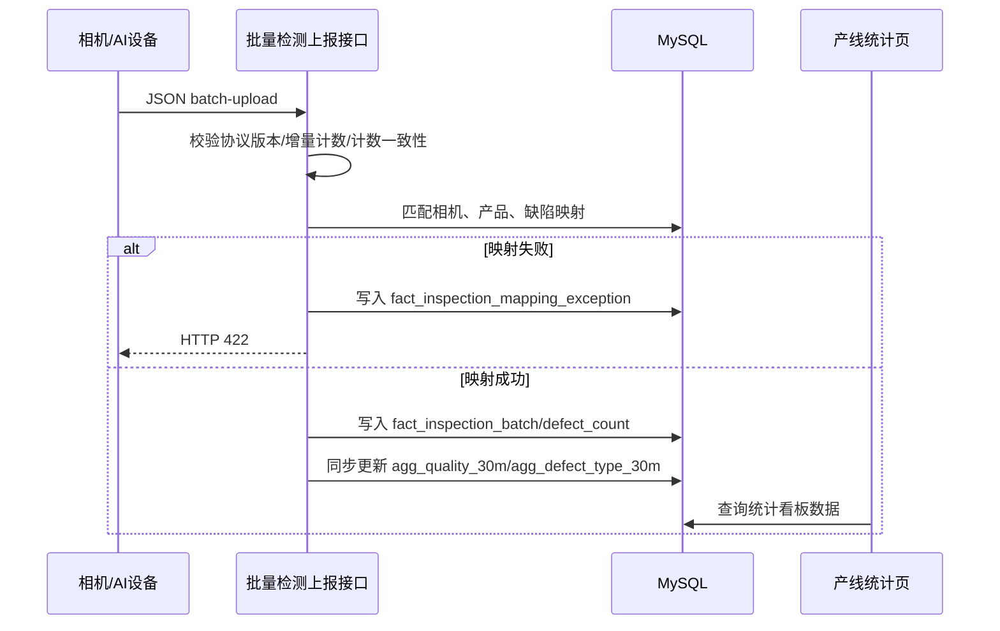

# 产线缺陷在线AI检测系统 — 项目完整说明与后续迭代资料

版本：v1.0.0  
整理时间：2026-06-20  
整理范围：`D:\45344\0004-软件源码` 当前前端、后端、数据库脚本、安装包与测试报告。

---

## 1. 项目定位

本项目是一个部署在 Windows 工控机/现场服务器上的本地化相机 AI 检测平台，核心目标是承接现场相机/AI 设备的三类上报数据，并在浏览器中实时展示相机状态、缺陷图片与产线质量统计。

系统名称：**产线缺陷在线AI检测系统**。

系统围绕以下业务闭环建设：



---

## 2. 当前系统边界

### 2.1 数据来源

当前只保留三类对外上报入口：

| 数据来源 | 接口 | 用途 |
|---|---|---|
| 相机运行状态 | `POST /api/v1/camera/status/heartbeat` | 更新相机运行状态、资源占用、故障信息、累计识别计数 |
| 相机缺陷图片 | `POST /api/v1/defect-images/upload` | 上传缺陷图片文件与 metadata，支持图片、缺陷框、严重度统计 |
| 相机检测统计 | `POST /api/v1/camera/inspection/batch-upload` | 上报检测总数、OK 数、NG 数、缺陷编码计数，驱动产线统计报表 |

### 2.2 页面范围

当前主导航保留 3 个核心 Tab：

1. **相机状态**：默认首页，展示相机运行状态、上传状态、最近图像入口、上传/识别统计。
2. **图像记录**：按相机一行一个对象展示缺陷图片，支持筛选、展开、图片预览、上一张/下一张切换。
3. **产线统计**：动态配置质量统计看板，支持图表配置、模板管理、聚合任务、大屏展示。

系统配置入口位于主界面右上方，主要用于基础资料维护、配置导入、操作日志、系统设置。

---

## 3. 技术架构

### 3.1 前端

| 项目 | 当前实现 |
|---|---|
| 框架 | Vue 3 |
| 构建工具 | Vite |
| UI 组件 | Element Plus |
| 图表 | ECharts |
| 状态管理 | Pinia |
| HTTP | Axios，统一 baseURL `/api` |
| 路由 | Vue Router，默认 `/camera-status` |
| 发布方式 | `npm run build` 后复制到 Spring Boot `static` 目录，由 8091 统一服务 |

关键目录：

| 路径 | 说明 |
|---|---|
| `D:\45344\0004-软件源码\frontend\src\components\Layout.vue` | 全局头部、筛选区、主 Tab、用户菜单 |
| `D:\45344\0004-软件源码\frontend\src\views\camera\CameraStatusView.vue` | 相机状态页 |
| `D:\45344\0004-软件源码\frontend\src\components\CameraImageRecords.vue` | 图像记录核心组件 |
| `D:\45344\0004-软件源码\frontend\src\views\stats\LineAnalyticsView.vue` | 产线统计动态看板 |
| `D:\45344\0004-软件源码\frontend\src\views\system\ConfigView.vue` | 系统配置聚合页 |
| `D:\45344\0004-软件源码\frontend\src\components\common` | 统一分页、空状态、异常状态、加载状态组件 |

### 3.2 后端

| 项目 | 当前实现 |
|---|---|
| 框架 | Spring Boot |
| 端口 | 8091 |
| 数据库 | MySQL 8.0 / `wms-new` |
| 数据访问 | MyBatis-Plus + MyBatis XML + JdbcTemplate |
| 鉴权 | JWT + 设备 Bearer Token 校验 |
| 静态资源 | Vue dist 集成到 Spring Boot `static` |
| 服务发布 | Windows Service Wrapper + 内置 JRE |
| 文件存储 | 安装目录外部运行路径下 `runtime/data/uploads/defect-images` |
| 日志 | `runtime/logs/camera-detection-system.log` |

关键控制器：

| 控制器 | 说明 |
|---|---|
| `AuthController` | 登录、注册、当前用户 |
| `CameraStatusHeartbeatController` | 相机状态心跳上报 |
| `DefectImageController` | 缺陷图片上传、图片记录查询、图片文件读取 |
| `BatchUploadController` | 新版检测统计批量上报 |
| `LineAnalyticsController` | 产线统计元数据、查询、看板、图表、聚合任务 |
| `FinalConfigController` | 产品、缺陷类型、相机缺陷映射、映射异常 |
| `ConfigImportController` | 工厂/产线/工位/相机配置导入导出 |
| `SysOperationLogController` | 操作日志查询、导出、删除、清空 |
| `SystemSettingsController` | 系统设置中心 |
| `SpaFallbackController` | Vue 路由 fallback |

---

## 4. 数据模型概览

当前数据库从“最终模型”角度组织，旧表可废弃，P0 不迁移旧数据，仅保留备份。

### 4.1 配置维度表

| 表 | 用途 |
|---|---|
| `dim_factory` | 工厂维度 |
| `dim_production_line` | 产线维度 |
| `dim_workstation` | 工位维度 |
| `dim_camera` | 相机维度，含相机编号、设备 ID、工厂/产线/工位绑定 |
| `dim_product` | 产品维度 |
| `dim_defect_type` | 缺陷类型维度，支持按产品配置 |
| `dim_defect_position` | 缺陷位置维度 |
| `dim_shift` | 班次维度 |
| `cfg_camera_token` | 相机设备 token 配置 |
| `cfg_camera_defect_mapping` | 相机上报编码到标准缺陷类型的一对一映射 |

### 4.2 事实表

| 表 | 用途 |
|---|---|
| `fact_camera_heartbeat` | 相机心跳明细 |
| `fact_camera_status_current` | 相机当前状态快照 |
| `fact_inspection_batch` | 检测统计上报批次 |
| `fact_inspection_defect_count` | 检测缺陷计数明细 |
| `fact_inspection_mapping_exception` | 检测上报映射异常 |
| `defect_image_batch` | 缺陷图片上传批次 |
| `defect_image_file` | 缺陷图片文件记录 |
| `defect_image_box` | 图片缺陷框 metadata |
| `sys_operation_log` | 用户操作记录 |

### 4.3 聚合表与配置表

| 表 | 用途 |
|---|---|
| `agg_quality_30m` | 30 分钟质量聚合 |
| `agg_defect_type_30m` | 30 分钟缺陷类型聚合 |
| `agg_quality_daily` / `agg_defect_type_daily` | 大时间范围日聚合，执行迁移后可用 |
| `cfg_analytics_dashboard` | 动态看板模板 |
| `cfg_analytics_widget` | 动态图表配置 |
| `cfg_analytics_aggregation_schedule` | 夜间日聚合配置 |
| `fact_analytics_aggregation_job` | 聚合任务记录 |
| `sys_system_setting` | 系统设置中心 |
| `sys_data_retention_policy` | 数据保留策略 |

---

## 5. 功能模块说明

### 5.1 登录与权限

- 登录页系统名称为“产线缺陷在线AI检测系统”。
- 登录成功后默认进入 `/camera-status`。
- 前端本地保存 token 与用户信息。
- 右上角展示角色和登录用户名，例如“系统管理员 · admin”。
- 管理类页面通过 `requiresAdmin` 做页面级拦截。

### 5.2 全局布局与筛选

- 头部固定展示班次、工厂、产线、工位筛选。
- 主 Tab 固定在页面上方，不随页面下滚消失。
- 工厂、产线、工位筛选通过 `/api/cascade/all` 获取层级数据。
- 全局分页统一默认 10 条，支持 10、20、50、100。

### 5.3 相机状态页

当前能力：

- 搜索相机名称/编号/工位。
- 按运行状态筛选：运行、停止、故障、待机、离线等。
- 默认关闭“异常优先”，按数据库自增/配置顺序展示。
- 展示相机名称、工位名称、相机编号、当前检测产品、检测总数、OK 数、缺陷数、CPU、内存、温度、故障信息、最近心跳/上传时间。
- 最近图像区域提供“图像记录”按钮，可跳转到对应相机的图像记录页。
- 状态来源：心跳运行状态 + 图片/检测上传状态分别计算。

状态口径：

| code | 枚举 | 中文 |
|---:|---|---|
| 0 | STOPPED | 停止 |
| 1 | RUNNING | 运行 |
| 2 | FAULT | 故障 |
| 3 | STANDBY | 待机 |
| 9 | OFFLINE | 离线，服务端按超时派生 |

### 5.4 图像记录页

当前能力：

- 一行展示一个相机对象。
- 支持关键字、严重度、缺陷类型、工厂/产线/工位、时间范围筛选。
- 支持按相机展开历史图片分页。
- 单个相机历史总数不再受“最近 200 张”限制。
- 图片点击后可弹窗查看，并支持上一张/下一张切换。
- 图片记录与文件链路经过一致性检查：当前 DB 记录无缺失文件；历史孤儿文件不影响页面展示。

核心 API：

- `GET /api/v1/defect-images/camera-summaries`
- `GET /api/v1/defect-images/history`
- `GET /api/v1/defect-images/file/**`

### 5.5 产线统计页

当前能力：

- 按时间、工厂、产线、工位、相机、产品、班次、缺陷类型、严重度筛选。
- 展示 KPI：检测总数、OK 数、NG 数、良率、缺陷数。
- 支持动态图表：折线图、柱状图、堆叠柱状图、排行图、透视表。
- 支持图表新增、编辑、删除、二次确认、保存后刷新。
- 支持图表独立筛选，或跟随全局筛选。
- 支持看板模板复制、另存为、删除。
- 支持大屏/最大化展示。
- 支持图表导出图片、Excel。
- 大时间范围查询自动走日聚合；支持夜间自动执行时间配置、任务列表、失败详情与重试。

### 5.6 系统配置页

当前聚合页面：`/system/config`。

| Tab | 当前能力 |
|---|---|
| 配置总览/工厂 | 按层级展示工厂，支持新增、编辑、删除依赖校验、分页 |
| 产线管理 | 依赖工厂，支持新增、编辑、删除依赖校验、分页 |
| 工位管理 | 依赖产线，支持新增、编辑、删除依赖校验、分页 |
| 相机管理 | 依赖工位，支持新增、编辑、删除依赖校验、分页 |
| 用户管理 | 用户增删改查、角色映射、状态展示 |
| 操作记录 | 查询用户操作记录，支持删除、清空、导出等操作 |

配置导入：

- 支持工厂、产线、工位、相机层级配置模板导出。
- 支持全量导入和增量导入的交互设计。
- 导入前进行风险提示，导入失败需要展示失败行、失败原因和处理建议。

产品、缺陷类型、相机缺陷映射当前由后端 `FinalConfigController` 提供接口，并作为产线统计和检测上报链路的核心配置；后续迭代建议继续并入系统配置 UI，形成统一配置中心。

---

## 6. 对外接口概要

### 6.1 通用响应结构

```json
{
  "code": 200,
  "message": "success",
  "data": {}
}
```

异常时：

```json
{
  "code": 422,
  "message": "字段或配置错误说明",
  "data": { "issues": [] }
}
```

### 6.2 相机状态心跳

`POST /api/v1/camera/status/heartbeat`

Header：

- `Authorization: Bearer <device-token>`
- `X-Device-Id: <cameraCode/deviceId>`

Body：

```json
{
  "cameraName": "杭州1线-上料相机A",
  "productName": "产品A",
  "timestamp": "2026-06-20 10:00:00",
  "cameraStatus": 1,
  "recognizeCount": 1000,
  "correctCount": 980,
  "abnormalCount": 20,
  "cpuUsage": 35.5,
  "memoryUsage": 62.1,
  "temperature": 45.2,
  "errorMessage": "",
  "resetFlag": false
}
```

注意：`cameraStatus` 仅允许 0、1、2、3；离线由服务端根据超时派生。

### 6.3 缺陷图片批量上传

`POST /api/v1/defect-images/upload`

请求类型：`multipart/form-data`

Header：

- `Authorization: Bearer <device-token>`
- `X-Device-Id: <cameraCode/deviceId>`
- 建议：`X-Image-Count: <本批图片数量>`，超过 100 可快速拒绝。

Form 字段：

| 字段 | 说明 |
|---|---|
| `files` 或 `file` | 图片文件数组，支持 jpg/jpeg/png/bmp/gif/webp/svg |
| `metadata` | JSON 字符串，描述 cameraId、uploadTime、images、defects |

关键规则：

- 单批最多 100 张图片。
- `metadata.images[].fileName` 必须与上传文件原始文件名一一匹配，包含扩展名。
- 同批次不允许重复文件名。
- 图片保存与数据库写入在事务中处理；单图失败会清理失败文件。
- 页面展示以 `defect_image_file` / `defect_image_box` 为准，文件路径由记录中的 `image_url` 加载。

### 6.4 检测统计批量上报

`POST /api/v1/camera/inspection/batch-upload`

Header：

- `Authorization: Bearer <device-token>`
- `X-Device-Id: <cameraCode/deviceId>`
- 可选：`X-Batch-Id: <batchId>`

关键规则：

- P0 只支持 `counterMode=INCREMENTAL`。
- `schemaVersion` 固定为 `2.0`。
- `totalCount = okCount + ngCount`。
- `ngCount = sum(defects[].count)`。
- `productName` 必须与产品配置完全匹配。
- `cameraCode` / `X-Device-Id` 必须能匹配系统配置中的相机。
- 每个 `sourceCode` 必须按“产品 + 相机 + sourceCode”映射到唯一标准缺陷类型，否则返回 HTTP 422，并记录映射异常。
- 重复 `batchId` 按幂等处理，不重复累加。
- P0 同步写入 30 分钟聚合表，保障产线统计实时查询。

---

## 7. 数据处理链路

### 7.1 心跳链路



### 7.2 缺陷图片链路



### 7.3 检测统计链路



---

## 8. 构建与发布

### 8.1 一键构建

```powershell
powershell -ExecutionPolicy Bypass -File D:\45344\0004-软件源码\build-release.ps1
```

构建过程：

1. 前端执行 `npm run build`。
2. 将 Vue dist 复制到后端 `src/main/resources/static`。
3. Maven 构建 Spring Boot JAR。
4. 编译 Windows Service Wrapper。
5. 复制内置 JRE、配置模板、脚本、SQL、文档。
6. 使用 Inno Setup 生成安装包。

### 8.2 发布目录

| 路径 | 说明 |
|---|---|
| `D:\45344\0004-软件源码\dist-release\CameraDetectionSystem` | 解压态发布目录 |
| `D:\45344\0004-软件源码\dist-release\installer\CameraDetectionSystem-Setup-1.0.0.exe` | Windows 安装包 |
| `D:\45344\0004-软件源码\dist-release\build-release-latest.log` | 最新构建日志 |

### 8.3 运行目录

默认安装目录示例：`D:\45344\0000-jar\CameraDetectionSystem`。

| 子目录 | 说明 |
|---|---|
| `app` | Spring Boot JAR |
| `config` | 外部配置 `application.yml` |
| `jre` | 内置 JRE |
| `service` | Windows 服务包装器 |
| `scripts` | 服务安装/启动/停止/卸载、自检、数据库初始化脚本 |
| `runtime/data/uploads/defect-images` | 缺陷图片上传目录 |
| `runtime/logs` | 运行日志目录 |
| `sql` | 数据库初始化 SQL |
| `docs` | 交付文档 |

---

## 9. 测试与验收现状

最近一次安装包级发布验证结果：

| 验收项 | 结果 |
|---|---|
| 安装包端到端验收 | PASS |
| 上线验收脚本 | PASS |
| 完整项目自动化测试 | 50/50 PASS |
| 新功能自动化测试 | 30/30 PASS |
| 相机状态跳图像记录专项 | PASS |
| 100 路相机心跳压测 | PASS |
| 100 张图片批量上传压测 | PASS |
| 图片一致性检查 | DB 缺失文件 0；历史孤儿文件 7 |

关键报告：

- `D:\45344\0004-软件源码\test-reports\安装包级发布验证汇总-latest.md`
- `D:\45344\0004-软件源码\test-reports\相机检测平台-测试报告-latest.md`
- `D:\45344\0004-软件源码\test-reports\新功能测试报告-latest.md`
- `D:\45344\0004-软件源码\test-reports\重点验收-相机图像记录跳转-latest.md`

---

## 10. 后续迭代建议

### P0：交付稳定性

- 在真实全新 Windows 电脑/虚拟机上完整执行安装向导。
- 验证安装时工作路径选择是否正确落地到服务运行参数和外部配置。
- 验证 MySQL 初始化脚本从空库一键导入。
- 验证 Windows 服务安装、启动、停止、卸载和异常恢复。
- 持续保留 100 路心跳、100 张图片批量上传压测。

### P1：现场使用体验

- 将产品、缺陷类型、缺陷位置、相机缺陷映射、映射异常正式并入系统配置 UI。
- 图像记录继续增强筛选：按批次、缺陷框数量、图片是否存在、上传结果等筛选。
- 产线统计图表配置向导继续降低误配成本。
- 配置导入失败提示继续产品化，支持失败 Excel 下载和二次导入。
- 操作日志增加高级查询、审计报表和敏感操作高亮。

### P2：工程治理

- 继续拆分 `LineAnalyticsController`、`StatsController`。
- 拆分 `ConfigView.vue`、`LineAnalyticsView.vue`。
- 将 JdbcTemplate SQL 逐步归拢 Repository 层。
- 数据库结构全面迁移到版本化 migration 管理。
- 增加后端单元测试、接口契约测试、前端组件测试和安装包验收自动化。

---

## 11. 已知注意点

1. 当前发布包中 `application.yml` 模板存在中文注释编码显示异常，不影响配置键值解析；后续建议统一用 UTF-8 无 BOM 重写模板注释。
2. 历史图片目录存在 7 个孤儿文件，当前 DB 不缺文件，不影响页面展示；可后续执行隔离清理。
3. 正式现场建议 MySQL 3306 仅本机开放，8091 提供页面与相机接口。
4. 设备侧必须固定传 `Authorization` 与 `X-Device-Id`，便于后续收紧安全策略。
